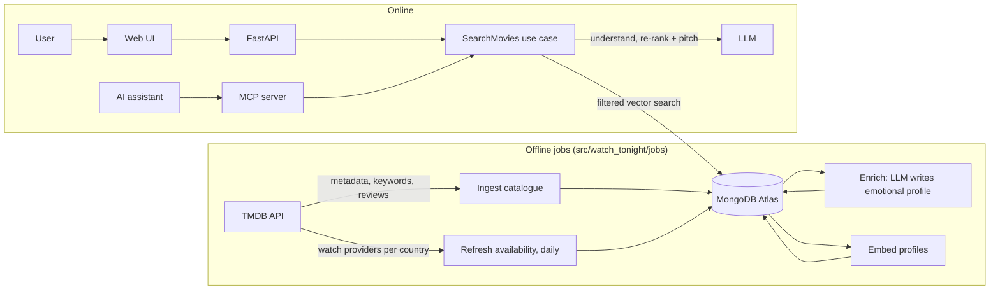

# Architecture (v0, draft)

**What this file is:** how watch-tonight is built. What it does and the rules it must keep are in `docs/product.md` (P1–P7); why each choice was made is in `docs/decisions/`.
**Status:** v0 draft (feat-005), written before the spikes. Points marked **(feat-0NN)** are open until that spike answers them; feat-012 turns the answers into ADRs and updates this file.

---

## 1. Components



| Component | Package | Responsibility |
|---|---|---|
| Ingest catalogue | `jobs` → `application` | Load new movies from TMDB into `movies`. Stored movies are re-fetched only on purpose (§4). |
| Refresh availability | `jobs` → `application` | Daily: rewrite `streamable` (flat-rate only, P1, **(feat-008)**) and `availability_updated_at` for every stored movie. |
| Enrich | `jobs` → `application` | LLM writes each movie's emotional profile from its data, with the evidence it used. |
| Embed | `jobs` → `application` | Turn each profile into a vector for search. |
| SearchMovies | `application` | The one online use case. API and MCP call it and return the same response model (US4). |
| API, MCP server | `api`, `mcp_server` | Thin adapters: parse input, call the use case, map results and errors. |
| Web UI | `web/` | Thin React client of the API (Q10); mobile-friendly (≈375 px). Tooling (bundler, tests) is decided in the UI slice. |

## 2. Layers and ports

`domain` ← `application` ← `infra`, `api`, `mcp_server`, `jobs` (enforced by import-linter; see `docs/conventions.md`). In C# terms: `domain` is the Core project with the interfaces and `infra` holds the implementations. Each entry point (`api`, `mcp_server`, `jobs`) is a composition root that wires `infra` adapters into the use cases (FastAPI `Depends` ≈ ASP.NET Core DI). Shared wiring code, if any, lives in one module all three import, never in `api`, so the MCP server and the jobs don't depend on FastAPI.

Ports are `Protocol`s in `domain` (draft names):

| Port | Implemented in `infra` by | Used for |
|---|---|---|
| `MovieSource` | TMDB client (httpx + retries) | Metadata and watch providers |
| `MovieRepository` | MongoDB | Read/write movies, record job runs |
| `CandidateSearch` | Atlas `$vectorSearch` | Filtered vector search |
| `LanguageModel` | Provider and model chosen in **(feat-011)** | Query intent, re-rank + pitches, emotional profiles (structured output) |
| `Embedder` | Model choice and runtime **(feat-010)** | Profile and query vectors (same model for both) |

Keeping each external service behind a port lets a provider be swapped (e.g. when a free tier runs out) without touching `application`, and lets unit tests use in-memory fakes.

## 3. Query flow (online)

1. **Validate** the request `{text, country, providers[], max_runtime?, max_intensity?, avoid[]?, exclude_ids[]}`: P4 (text ≤ 500 chars, not empty), supported country, at least one provider. UI constraints are picked from fixed options (`max_intensity` and `avoid` from the closed vocabulary below), so they never go through the LLM (P3). Failure → *Invalid input* state.
2. **Understand:** the LLM is the middle man between the user and the data (Q11). It turns the text, in any language (Q9), into a typed intent (Pydantic model):
   - wanted tone and themes;
   - structured filters extracted from the text, drawn only from a **closed vocabulary** shared with the profile schema (max runtime, content warnings from a fixed list, intensity on a fixed scale), so every filter matches a real field;
   - an English summary to embed.

   UI constraints are merged in as given. If this call fails, or its output is still invalid after one retry **(feat-011)**, the response is *Service unavailable*: without an intent there is nothing reliable to search with (Q8).
3. **Retrieve:** embed the summary; `$vectorSearch` with a pre-filter **(feat-009)**: `streamable` contains one of `{country}:{provider}`, `runtime ≤ max_runtime`, `_id ∉ exclude_ids`, plus the intent's avoid/intensity filters if Atlas supports them as pre-filters. Take the top 30–50 candidates.
4. **Check candidates (deterministic, in `application`):** drop every candidate that breaks P1 (availability re-checked) or P3 (runtime by value; avoid and intensity by comparing the intent's filters with the profile fields, never by asking an LLM). If fewer than 5 remain, the response will be *Partial*, with the product.md §4 note.
5. **Re-rank and pitch:** the LLM picks up to 5 of the remaining candidates and writes a pitch for each that follows P2 and ADR 0001 (≤ 350 chars). Because it only sees valid candidates, the flow stays at 2 LLM calls per query.
6. **Check the LLM's output (deterministic):** every picked ID is one of the step-4 candidates (no invented titles), pitch length (P2), response schema valid. On failure, retry the call **(feat-011)**. If it still fails (or the LLM is down at this step), return up to 5 step-4 candidates by search score without pitches: the *Results without pitches* state (Q8). It is never *Partial* because of the LLM, since that note ("add a service or relax a constraint") would mislead. But if step 4 already left fewer than 5 candidates, the response also carries the *Partial* note.
7. **Respond:** `state` (*Success*, *Partial* or *Results without pitches*) and its `note` when there is one. Each result has title, year, runtime, poster URL, services, pitch (when available), TMDB link and its own `availability_updated_at` (P6; a refresh can be half done). Also attribution (P5) and a `trace` (stage timings, tokens, estimated cost).

US3 needs no accounts: the client sends the IDs it has already shown as `exclude_ids`.

## 4. Offline pipeline

- **Corpus:** popular movies with a flat-rate provider in ES, US or BO; 5–20k, bounded by TMDB rate limits **(feat-008)**, the Atlas free tier **(feat-009)**, embedding time **(feat-010)** and LLM cost for enrichment **(feat-011)**.
- **Profile quality drives recommendation quality.** The richer and more accurate the movie data and its emotional profile, the better the results. So the profile schema (including the closed vocabulary of step 2), the enrichment prompt and a profile-quality eval on a sample the owner rates get their own feature when the backlog is sliced (feat-012).
- **Movie data is ingested once.** Metadata (title, overview, keywords, credits, poster path) is treated as unchanging; only availability changes. It is fetched again only on purpose, e.g. to add a new field to the schema, or if TMDB's terms limit how long it may be stored **(feat-008)**.
- **Idempotency:**
  - each movie stores a `source_hash` of the inputs used to build its profile, plus the profile's `prompt_version`;
  - enrichment and embedding re-run only when the hash, the prompt version or the embedding model changed;
  - every job run is recorded in `ingestion_runs` (counts, duration, errors).
- **Refresh** touches only `streamable` and `availability_updated_at` of stored movies, so it is cheap to run daily. Movies that become streamable later enter the corpus only when ingest, enrich and embed re-run; their schedule is open (Q12).

## 5. Data model (MongoDB sketch)

```jsonc
// movies (_id = TMDB id)
{
  "_id": 603, "title": "The Matrix", "year": 1999, "runtime": 136,
  "genres": ["Action", "Science Fiction"], "keywords": ["simulated reality"],
  "overview": "…", "credits": {"directors": ["…"], "cast": ["…"]},
  "poster_path": "/abc123.jpg",               // TMDB image path; URL built at display time (feat-008)
  "review_snippets": ["…"],                   // only if TMDB terms allow it (feat-008)
  "streamable": ["ES:8", "US:8"],             // "country:provider", flat-rate only (P1)
  "availability_updated_at": "2026-11-09T03:00:00Z",
  "profile": {"tone": ["dark"], "pacing": "fast", "intensity": 4, "themes": ["identity"],
              "content_warnings": ["violence"], "summary": "…", "evidence": ["overview"],
              "model": "…", "prompt_version": "p1"},
  "embedding": [/* floats */], "embedding_model": "…",   // model and size: feat-010
  "source_hash": "…", "updated_at": "…"
}
// also: providers (id, name, logo per country), ingestion_runs, eval_runs
```

`streamable` is flattened to strings so the vector-search pre-filter stays a simple indexed field **(feat-009)**. The exact profile fields are refined with real examples when enrichment is built.

## 6. Cross-cutting

- **Configuration and secrets:** `pydantic-settings` reads environment variables (`.env` locally, never committed; `.env.example` lists them). Like `IOptions<T>` bound from configuration.
- **Errors:** domain exceptions (e.g. `PromptValidationError`) map to the response states. API: 422 for invalid input, 503 for *Service unavailable*. MCP: a tool error with the same message. No made-up results when the LLM or database is down.
- **Observability:** the per-response `trace` (above) and the `ingestion_runs` records are the raw data; which metrics are reported, and how, is `docs/metrics.md` (feat-006).
- **Evals (`evals/`, owner-approved, protected by the PR gate):**
  - deterministic evals run in CI at 100%: P1, P3 on the constraints as applied, P4, pitch length, real catalogue IDs, output schema;
  - quality evals:
    - constraint extraction (P3): golden queries with their expected filters, including non-English input (Q9);
    - retrieval precision@5 on a golden set of 30–50 owner-labelled queries;
    - pitch quality judged by an LLM calibrated against the owner's labels.
- **Tests:** unit tests on `domain` and `application` with fake ports; integration tests on `infra` against the `mongodb-atlas-local` container **(feat-009)**, marked `integration`; acceptance tests per spec.
- **Hosting:** API, UI and the daily job on a free tier **(feat-010)**: memory limits decide the embedding runtime.
- **Cost:** zero by default (product.md §1). Images are linked from TMDB, never stored. The `trace` records the estimated cost of every query, and any paid service or recurring cost needs the owner's approval.

## 7. Questions

### Open

| # | Question | Answered by | Changes |
|---|---|---|---|
| Q1 | TMDB terms: storing metadata and review excerpts, caching rules, exact attribution (TMDB and JustWatch) | feat-008 | Data model, enrichment inputs, P5 wording |
| Q2 | TMDB rate limits and flat-rate provider coverage in ES, US and BO (is BO usable?) | feat-008 | Corpus size, countries at launch |
| Q3 | Atlas free tier: storage, vector index limits, pre-filter on an array field + range + `$nin` | feat-009 | Corpus size, `streamable` design, query step 3 |
| Q4 | Does `mongodb-atlas-local` run `$vectorSearch` on both machines (Mac ARM, Windows x86)? | feat-009 | Integration tests |
| Q5 | Embedding model and where it runs at query time; which free host fits | feat-010 | `Embedder`, container image, hosting |
| Q6 | Runtime LLM: provider and model (Gemini free tier vs a low-cost OpenAI model), cost per query and per 1,000 profiles, data use, structured output (incl. non-English input), latency, framework (Pydantic AI vs SDK), fallback provider | feat-011 | `LanguageModel`, enrichment cost, latency budget, privacy note |
| Q7 | p95 latency target (product.md: to confirm, guess < 10 s) | Measured in the first end-to-end slice (feat-012 plans it) | Number of LLM calls, caching |
| Q12 | How often do ingest, enrich and embed re-run to add newly streamable movies? | feat-008 (rate of change), then feat-012 | Job schedule, LLM and embedding cost |
| Q13 | Movies without a TMDB poster: show a placeholder, or leave them out of the corpus? | Owner, with feat-008's numbers (how many lack one) | Corpus, UI, US1 acceptance |

### Decided (owner, 2026-11-13)

| # | Question | Decision | Recorded in |
|---|---|---|---|
| Q8 | What to return when the LLM fails | The understanding call fails → *Service unavailable*. The re-rank call fails or its output stays invalid after a retry → the valid results without pitches. | product.md §4, query steps 2 and 6 |
| Q9 | Non-English input | Any input language; UI, titles and pitches in English, and the UI says so. The LLM writes the intent in English. | product.md §2, query step 2 |
| Q10 | Frontend framework | React. Tooling is decided in the UI slice. | §1 |
| Q11 | How "avoid" and intensity constraints are checked | The LLM translates the free text into structured filters over a closed vocabulary shared with the profile schema; the data layer applies them deterministically (as Atlas pre-filters if supported, feat-009) and step 4 re-checks them. Defining the vocabulary is part of the profile feature (§4); the ADR comes with feat-012. | product.md P3, query steps 2–4 |
