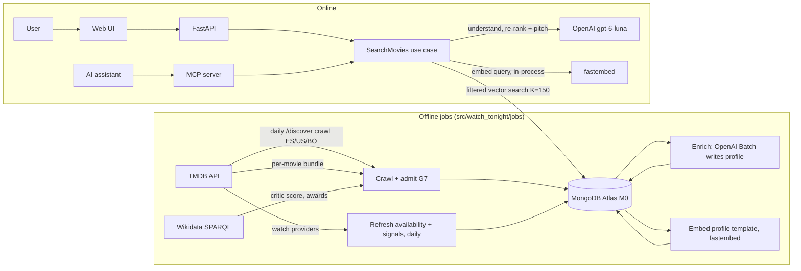

# Architecture (v1)

**What this file is:** how watch-tonight is built. What it does and the rules it must keep are in `docs/product.md` (P1–P7); why each choice was made is in `docs/decisions/`.
**Status:** v1 (feat-012, 2026-11-16).
- It applies the spikes on TMDB (feat-008), Atlas (feat-009), embeddings (feat-010), the runtime LLM (feat-011) and recommendation quality (feat-016), plus the owner decisions in §7.
- ADRs 0005–0008 record the main choices.
- Points marked **(slice)** are confirmed while building, not before.

---

## 1. Components



| Component | Package | Responsibility |
|---|---|---|
| Crawl + admit | `jobs` → `application` | Daily `/discover/movie` crawl of flat-rate films in ES/US/BO, sliced by release window. Films that pass gate **G7** and aren't stored yet are fetched (one bundle call each) and stored (§4). |
| Refresh | `jobs` → `application` | Daily: `streamable`, `availability_updated_at` and `unstreamable_since` per stored movie (flat-rate only, P1), plus TMDB `popularity`, `vote_*` and `quality_score` from the crawl. |
| Enrich | `jobs` → `application` | The LLM writes each new movie's profile (v1 schema, ADR 0005) from TMDB data only, through the OpenAI Batch API. |
| Embed | `jobs` → `application` | Turn `template(profile)` into a 384-d vector (ADR 0007). |
| SearchMovies | `application` | The one online use case. API and MCP call it and return the same response model (US4). |
| API, MCP server | `api`, `mcp_server` | Thin adapters: parse input, call the use case, map results and errors. |
| Web UI | `web/` | Thin React client of the API (Q10); mobile-friendly (≈ 375 px); shows the age and privacy notes (Q14). Tooling is decided in the UI slice. |

## 2. Layers and ports

`domain` ← `application` ← `infra`, `api`, `mcp_server`, `jobs` (enforced by import-linter; see `docs/conventions.md`).
- In C# terms, `domain` is the Core project with the interfaces, and `infra` holds the implementations.
- Each entry point (`api`, `mcp_server`, `jobs`) is a composition root that wires `infra` adapters into the use cases (FastAPI `Depends` ≈ ASP.NET Core DI).
- Shared wiring code, if any, lives in one module all three import, never in `api`, so the MCP server and the jobs don't depend on FastAPI.

Ports are `Protocol`s in `domain`:

| Port | Implemented in `infra` by | Used for |
|---|---|---|
| `MovieSource` | TMDB client (httpx, retries, ≤ 25 req/s measured safe) | `/discover` crawl, per-movie bundle, watch providers |
| `QualitySignals` | Wikidata SPARQL (CC0) | `critic_score`, `awards_count`, looked up by TMDB ID (P4947) (Q15); when missing, ranking falls back to TMDB WR |
| `MovieRepository` | MongoDB via `pymongo.AsyncMongoClient` (Motor is deprecated, feat-009) | Read/write movies, record job runs |
| `CandidateSearch` | Atlas `$vectorSearch`, one vector index with the filter paths declared | Filtered vector search, K = 150 |
| `LanguageModel` | OpenAI `gpt-6-luna` via Pydantic AI (ADR 0006) | Query intent, re-rank + pitches, profiles |
| `Embedder` | `fastembed` `BAAI/bge-small-en-v1.5`, 384-d, ONNX CPU, in-process (ADR 0007) | Profile and query vectors (same model for both) |

Keeping each external service behind a port lets a provider be swapped without touching `application`, and lets unit tests use in-memory fakes.

## 3. Query flow (online)

1. **Validate** the request `{text, country, providers[], max_runtime?, max_intensity?, avoid[]?, exclude_ids[]}`.
   - Checks: P4 (text ≤ 500 chars, not empty), supported country, and at least one provider from the curated list for that country (spike 08 Q5).
     - The skeleton seeds a minimal static list of the main services.
     - feat-020 builds the real list. Aliasing ad tiers and channels onto a parent service is applied only when writing `streamable`, and only if catalogue overlap proves it safe for P1 **(slice)**.
   - UI constraints are picked from fixed options (`max_intensity` and `avoid` from the closed vocabulary), so they never go through the LLM (P3).
   - Failure → *Invalid input* state.
2. **Understand:** the LLM turns the text, in any language (Q9), into a `QueryIntent` (ADR 0005) with three channels:
   - **hard filters** from the closed vocabulary: `max_runtime_minutes`, `max_intensity`, `avoid`, `year_min`/`year_max`, `audience` (kids/teens), `original_languages`;
   - **semantic fields:** `tone`, `pacing`, `viewing_effort`, `ending_feel`, `humor_style`, `themes`, and an English `semantic_description` written in profile style;
   - **ranking controls:** `specificity`, `era_mode`, `acclaim_preference`;
   - **`unmapped_constraints`:** things the text asks to avoid or require that the vocabulary can't express (e.g. "no spiders"). They are not applied, and the response tells the user (Q18).

   UI constraints are merged in as given. When the UI and the text set the same constraint, the stricter one applies (e.g. UI 120 min + text "under 90 minutes" → 90), and `avoid` lists are combined, so P3 holds for both.

   Validation errors are retried once with the error fed back (`ModelRetry`, ADR 0006; shown so far only with a scripted fake **(slice)**). Cosmetic problems are fixed deterministically instead, e.g. tones truncated to 3. If the call still fails, the response is *Service unavailable* (Q8).
3. **Retrieve:** embed `semantic_description`, then run `$vectorSearch` with `limit = 150` and a pre-filter:
   - `streamable` contains one of `{country}:{provider}`;
   - `runtime ≤ max_runtime`, `_id ∉ exclude_ids`;
   - `profile.intensity ≤`, `profile.content_warnings ∉ avoid`;
   - the `year` range, `original_language` in the list;
   - the `audience` rule (Q16).

   - **What's verified:** spike 09 verified the first five filters together on M0, including `$nin` on 5,000 IDs.
   - **Still to verify in feat-018 (slice):**
     - the `year`, `original_language` and certification paths;
     - the `audience` rule, which needs an `$or` that also matches films with a null certification.
     - If Atlas can't express it, `audience` is applied in step 4 only.
   - `numCandidates` and the latency at K = 150 need the full corpus on M0, so they're measured in feat-021.
4. **Check and rank candidates (deterministic, in `application`):**
   - Drop every candidate that breaks P1 (availability re-checked), US3 (`_id` in `exclude_ids`) or P3 (runtime, avoid, intensity, year, language and audience, re-checked by value, never by an LLM).
   - Re-score with the hybrid formula (ADR 0008): similarity on a fixed scale, plus quality, era and popularity.
     - Weighted by `specificity`, `era_mode` and `acclaim_preference`.
     - The scale and the weights are set in feat-022. Until then, the skeleton orders candidates by similarity.
   - Keep one film per `collection_id` (films without a collection are never deduped) and pass the top 25 to step 5.
   - If fewer than 5 remain, the response will be *Partial*, with the product.md §4 note.
5. **Re-rank and pitch:**
   - The LLM picks up to 5 of the 25 and writes a pitch for each, following P2 and ADR 0001 (≤ 350 chars).
   - It sees each candidate's data and profile fields, plus the intent's semantic fields as context.
   - Because it only sees valid candidates, the flow stays at 2 LLM calls per query.
6. **Check the LLM's output (deterministic):**
   - Every picked ID is one of the step-4 candidates (no invented titles); no duplicates; exactly `min(5, number of candidates)` picks; pitch length (P2); valid schema.
   - On failure, retry once with the error fed back.
   - If it still fails (or the LLM is down at this step), return up to 5 step-4 candidates **by hybrid score**, without pitches: the *Results without pitches* state (Q8).
   - It is never *Partial* because of the LLM. But if step 4 already left fewer than 5 candidates, the response also carries the *Partial* note.
7. **Respond:**
   - `state` (*Success*, *Partial* or *Results without pitches*) and `notes`: zero or more user-facing notes. These are the pitches note, the *Partial* note, and the "couldn't apply" note listing `unmapped_constraints` (Q18).
   - Each result: title, year, runtime, poster URL, services, pitch (when available), TMDB link, and its own `availability_updated_at` (P6).
   - Also attribution (P5) and a `trace`: stage timings, tokens, estimated cost.

US3 needs no accounts: the client sends the IDs it has already shown as `exclude_ids`.

**Measured so far** (feat-011 used a simpler prompt: 40 candidates with TMDB overviews and a placeholder vocabulary; v1 sends 25 candidates with profile fields):
- both LLM calls together: p50 ≈ 5.0 s and p95 ≈ 6.3 s (feat-011, from a laptop in Spain);
- query embedding ≈ 5 ms (feat-010);
- `$vectorSearch` on M0: p95 121 ms at limit 40 (feat-009);
- cost ≈ $0.00067 per query.

## 4. Offline pipeline

- **Corpus: gate G7** (feat-016, ADR 0008) over the flat-rate films of ES, US and BO. It keeps ≈ 14.5k of 51.5k films, ≈ 20% of M0. G7 requires:
  - TMDB votes ≥ 20 if the film is ≤ 1 year old, ≥ 60 if ≤ 3, ≥ 120 if ≤ 10, otherwise ≥ 200;
  - Bayesian `quality_score` (WR) ≥ 5.0;
  - WR ≥ 6.3 if the film is more than 25 years old;
  - admission data checks: an overview, a poster (Q13), `runtime > 0` (TMDB uses 0 for unknown, which would wrongly pass `runtime ≤ max`), and at least one genre.
- **WR constants are pinned:** `C = 6.08` and `m = 50`, computed from the 2026-11-16 catalogue (feat-016). They are recomputed only on purpose, as a gate revision, so `quality_score` and the gate don't drift day to day.
- **Admission over time:** the daily crawl admits any crawled film that passes G7 and isn't stored. The gate applies at admission only: a stored film that later drops below G7 stays.
- **Inputs:**
  - TMDB metadata, keywords (drop `*stinger`), credits, certifications (US and ES), collection;
  - Wikidata critic score and awards (CC0, internal only).
  - **No IMDb data and no reviews** (Q15).
- **Metadata freshness:**
  - TMDB `popularity`, `vote_*` and `quality_score` are refreshed daily from the crawl, at no extra calls.
  - Other metadata is fetched at admission and fetched again on purpose: a new schema field, or TMDB's storage terms. TMDB expects a daily availability refresh plus periodic metadata re-ingest (spike 08 Q1).
  - feat-020 owns the re-fetch policy **(slice)**: recent films (whose keywords and certifications fill in after release), plus a periodic full re-ingest (≈ 14.5k calls, ≈ 10 min). When a re-fetch changes the profile inputs, `source_hash` triggers re-enrichment.
- **Profile quality drives recommendation quality.** The profile design feature anchors the vocabulary definitions (`viewing_effort` came out nearly binary in feat-016), writes the enrichment prompt, and adds a profile-quality eval on an owner-rated sample.
- **Enrichment:** OpenAI Batch API, `gpt-6-luna`. G7 costs ≈ $1.03 once and a new film ≈ $0.00007. These figures come from the price list; feat-016 used standard calls, and the Batch path and its Pydantic AI support are checked in feat-021 **(slice)**.
- **Idempotency:**
  - each movie stores a `source_hash` of the inputs used to build its profile, plus `prompt_version`, `model` and `embedding_model`;
  - enrichment and embedding re-run only when one of them changed;
  - every job run is recorded in `ingestion_runs` (counts, duration, errors).
- **Refresh and retention (Q17):**
  - Keep films that leave streaming (`streamable: []`, `unstreamable_since` set). No eviction job in the MVP.
  - Films missing from every region's crawl get `streamable: []` with no per-movie call, and `/watch/providers` is called only for listed films; the ingest slice builds it **(slice)**. feat-017 checked it: all 32 G7 films that left had no flat-rate offer in any launch country. A `/discover` miss (2 of 325 sampled leavers) hides a streamable film for a while; it never recommends a film that isn't streamable (P1).
  - **Churn (feat-017, one 5.3-day window):** G7 films leave all launch countries at ≈ 6 a day and are admitted at ≈ 24.5 a day, mostly older films entering a service. Storage grows with admissions (≈ +63 MiB a year, extrapolated), about 4× faster than films leave, so the gate, not eviction, is the main storage lever. Detail: spike 16 Q1.

## 5. Data model (MongoDB, v1)

```jsonc
// movies (_id = TMDB id)
{
  "_id": 603, "title": "The Matrix", "original_title": "The Matrix", "original_language": "en",
  "year": 1999, "runtime": 136, "genres": ["Action", "Science Fiction"],
  "keywords": ["simulated reality"], "overview": "…", "tagline": "…",
  "credits": {"directors": ["…"], "cast": ["… top 5"]},
  "collection_id": 2344, "certification_us": "R", "certification_es": "18",   // null when none (Q16)
  "poster_path": "/abc123.jpg",                       // URL built at display time
  "tmdb_vote_average": 8.2, "tmdb_vote_count": 27000, "tmdb_popularity": 31.4,
  "quality_score": 8.1,                               // Bayesian WR from TMDB votes (refreshed daily)
  "critic_score": 73, "awards_count": 4,              // Wikidata, internal only (Q15)
  "streamable": ["ES:8", "US:8"],                     // "country:provider", flat-rate only (P1)
  "availability_updated_at": "2026-11-16T03:00:00Z",
  "unstreamable_since": null,                         // set when streamable empties (Q17)
  "profile": {
    "tone": ["dark", "tense"], "pacing": "fast", "intensity": 4,
    "viewing_effort": "engaging", "ending_feel": "tense_cathartic", "humor_style": "none",
    "content_warnings": ["violence"], "themes": ["identity", "control"],
    "summary": "… how it feels to watch, ≤ 400 chars"
  },
  "embedding": [/* 384 floats */], "embedding_model": "BAAI/bge-small-en-v1.5",
  "prompt_version": "p1", "model": "gpt-6-luna", "source_hash": "…", "updated_at": "…"
}
// also: providers (curated list per country: id, name, logo, aliases of ad tiers and channels
//       onto the parent service; spike 08 Q5), ingestion_runs, eval_runs
```

- `streamable` is flattened to strings so the pre-filter stays a simple indexed field.
- Filter paths declared in the vector index: `_id` (for `exclude_ids`), `streamable`, `runtime`, `year`, `original_language`, `certification_us`, `certification_es`, `profile.intensity`, `profile.content_warnings`. Every path used in the filter must be declared, or Atlas raises `OperationFailure` (spike 09).
- **No `review_snippets`** (Q15).
- Whether profiles keep an `evidence` field is decided in the profile design feature.

## 6. Cross-cutting

- **Configuration and secrets:** `pydantic-settings` reads environment variables (`.env` locally, never committed; `.env.example` lists them). Like `IOptions<T>` bound from configuration.
- **Errors:**
  - Domain exceptions (e.g. `PromptValidationError`) map to the response states.
  - API: 422 for invalid input, 503 for *Service unavailable*. MCP: a tool error with the same message.
  - No made-up results when the LLM or the database is down.
- **Observability:** the per-response `trace` and the `ingestion_runs` records; which metrics are reported, and how, is in `docs/metrics.md`.
- **Evals (`evals/`, owner-approved, protected by the PR gate):**
  - deterministic evals run in CI at 100%: P1, P3 on the constraints as applied, P4, pitch length, real catalogue IDs, output schema;
  - quality evals:
    - constraint extraction (P3): golden queries with expected filters, including non-English input;
    - retrieval relevance on 30–50 owner-labelled queries (this also tunes the hybrid weights, ADR 0008);
    - profile quality on an owner-rated sample;
    - pitch quality judged by an LLM calibrated against owner labels.
  - The LLM judge disagreed with itself on 26% of items in feat-016, so judge-based differences under about 0.1 are not evidence.
- **Tests:**
  - unit tests on `domain` and `application` with fake ports;
  - integration tests on `infra` against the `mongodb-atlas-local` container, marked `integration`;
  - acceptance tests per spec.
- **Hosting:** API and the daily job on a free tier: Google Cloud Run or Azure Container Apps, with Render Free plus a GitHub Actions cron as the fallback (feat-010).
  - The in-process embedder adds ≈ 212 MB to the image and needs ≈ 279 MB RSS at query time.
  - The UI host is decided in the UI slice.
- **Cost:** OpenAI usage only (Q6): ≈ $0.67 per 1,000 queries and ≈ $1.03 once for the corpus, capped by the prepaid balance. Everything else is free tier. Images are linked from TMDB, never stored.

## 7. Questions

### Open

| # | Question | Answered by | Changes |
|---|---|---|---|
| Q4 | Does `mongodb-atlas-local` run `$vectorSearch` on both machines? It ran on the Mac (feat-009), and the image is published for `linux/amd64`. The Windows run is pending because Docker Desktop wasn't running during feat-012. | Walking skeleton's integration tests (feat-018) | Integration tests on Windows |
| Q7 | p95 latency target (product.md: to confirm, guess < 10 s). The LLM calls alone are p95 ≈ 6.3 s from a laptop. | feat-018 (end to end, local, small corpus), feat-021 (`$vectorSearch` at K = 150 on M0), feat-025 (from the host) | Number of LLM calls, K, caching |
| Q12 | How often new films are admitted, and the churn rate. Plan: the daily `/discover` crawl admits films that pass G7. **Measured in feat-017** over one 5.3-day window: ≈ 24.5 G7 admissions and ≈ 6 departures a day, and ≈ 31 G7 films a day lost flat-rate in at least one launch country, so the crawl, availability refresh and admission stay daily (spike 16 Q1). Still open: the rates over months, from `ingestion_runs`, and the full re-ingest cadence (feat-020). | feat-017 (done), ingest slice (feat-020) | Job schedule, cost |

### Decided (owner and spikes, 2026-11-13 to 2026-11-16)

| # | Question | Decision | Recorded in |
|---|---|---|---|
| Q1 | TMDB terms | Non-commercial use is allowed. Storing metadata for the app's own search is allowed, but bulk redistribution is not. Don't persist reviews (Q15). Don't train models on TMDB data. Attribution: the TMDB logo and the notice in P5, plus "Streaming availability by JustWatch". | docs/spikes/08-tmdb-and-providers.md Q1–Q2 |
| Q2 | TMDB rate limits and coverage; is BO usable? | 25 req/s measured with 0 `429`s; ≈ 14 min for 20k bundle calls. **BO is usable** (62% of the Popular 500 are on flat-rate). G7 coverage: ES 9,952, US 11,961, BO 6,835 films. | spike 08 Q3–Q5, spike 16 §5 Q1 |
| Q3 | Atlas free tier and pre-filters | The 14.5k-film corpus fits M0 at ≈ 20% (384-d). Up to 3 vector indexes, and we need 1. The **5 tested filters** (`streamable`, `runtime`, `_id` `$nin` on 5,000 IDs, `profile.intensity`, `profile.content_warnings`) combine in one `$vectorSearch`. The v1 additions are verified in feat-018 (§3 step 3). | spike 09 Q1–Q2 |
| Q5 | Embedding model and runtime; hosting | `fastembed` `BAAI/bge-small-en-v1.5` (384-d) in-process: p50 5 ms, 279 MB RSS, +212 MB image. Hosting on Cloud Run or ACA (free). | ADR 0007, spike 10 |
| Q6 | Runtime LLM: provider, model, cost, data use, framework, fallback | **OpenAI only, `gpt-6-luna`**, online and for enrichment (Batch). The owner approved a small usage-based spend, capped by the prepaid balance. **No Gemini.** No second provider as fallback; an outage maps to *Service unavailable* / *Results without pitches* (Q8). Framework: Pydantic AI. | ADR 0006, spike 11 |
| Q8 | What to return when the LLM fails | The understanding call fails → *Service unavailable*. The re-rank call fails or its output stays invalid after a retry → the valid results without pitches. | product.md §4, query steps 2 and 6 |
| Q9 | Non-English input | Any input language. UI, titles and pitches are in English, and the UI says so. The LLM writes the intent in English. | product.md §2, query step 2 |
| Q10 | Frontend framework | React. Tooling is decided in the UI slice. | §1 |
| Q11 | How "avoid", intensity and the other constraints are checked | The LLM translates the free text into a `QueryIntent` over a closed vocabulary that mirrors the profile and movie fields. The data layer applies the filters as Atlas pre-filters, and step 4 re-checks them deterministically. | ADR 0005, spike 16 §5 Q3 |
| Q13 | Movies without a TMDB poster | Left out at admission. None of the 980 films sampled in feat-008 (Popular 500 plus 480 deep flat-rate) lacked one. | spike 08 Q6, §4 |
| Q14 | Minors | General-audience app for adults, OpenAI only. The UI shows the age note and the privacy note (product.md §2). | product.md §2, spike 11 §Q2 |
| Q15 | External data for quality and enrichment | **No IMDb data** (its licence bars building a database; it adds ≈ 2%). **No TMDB reviews** in enrichment (no gain, +35% tokens). Quality comes from TMDB WR. `critic_score` and `awards_count` come from Wikidata (CC0), internal only. | ADR 0008, spike 16 §5 Q2 |
| Q16 | `audience` filter when a film has no certification | US certification, else ES, else the profile:<br>- kids: US G/PG, else ES `A`/`Ai`/`7`/`7i`, else `intensity ≤ 2` and none of violence, gore, sexual_content, nudity, sexual_violence, horror_scares, drug_use, strong_language, self_harm, child_harm, animal_harm;<br>- teens: US ≤ PG-13, else ES up to `12`, else `intensity ≤ 3` and none of sexual_content, nudity, sexual_violence, gore.<br>Certifications are the first non-empty, non-`NR` value in TMDB `release_dates`. | product.md P3, ADR 0005, spike 16 §5 Q3 |
| Q18 | Constraints the closed vocabulary can't express (e.g. "no spiders") | They are not applied, and the response says so with a short note, e.g. *"We couldn't apply: no spiders"*. Results are still returned. (Owner, 2026-11-16.) | §3 steps 2 and 7, ADR 0005 |
| Q17 | Movies that leave streaming | Keep them (`streamable: []`). No eviction job in the MVP. `unstreamable_since` allows adding eviction if storage passes ≈ 60% of M0. | spike 16 §5 Q1, §4 |
