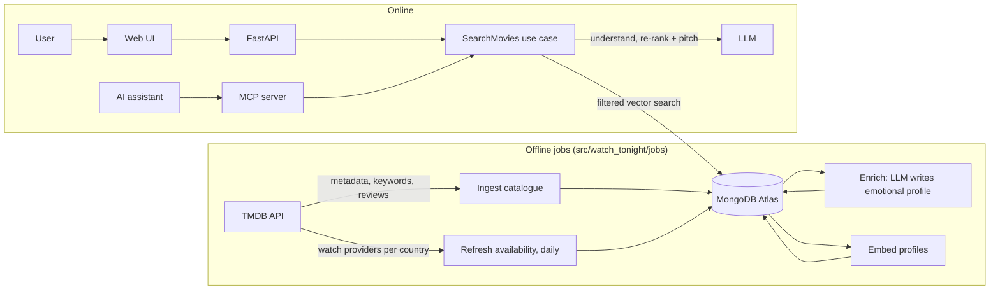

# Architecture (v0, draft)

**What this file is:** how watch-tonight is built. What it does and the rules it must keep are in `docs/product.md` (P1–P7); why each choice was made is in `docs/decisions/`.
**Status:** v0 draft (feat-005), written before the spikes. Points marked **(feat-0NN)** are open until that spike answers them; feat-011 turns the answers into ADRs and updates this file.

---

## 1. Components



| Component | Package | Responsibility |
|---|---|---|
| Ingest catalogue | `jobs` → `application` | Load the movie corpus from TMDB into `movies`. Re-running changes nothing unless the source changed. |
| Refresh availability | `jobs` → `application` | Daily: rewrite `streamable` (flat-rate only, P1) and `availability_updated_at` for every movie. |
| Enrich | `jobs` → `application` | LLM writes each movie's emotional profile from its data, with the evidence it used. |
| Embed | `jobs` → `application` | Turn each profile into a vector for search. |
| SearchMovies | `application` | The one online use case. API and MCP call it and return the same response model (US4). |
| API, MCP server | `api`, `mcp_server` | Thin adapters: parse input, call the use case, map results and errors. |
| Web UI | `web/` | Thin client of the API; mobile-friendly (≈375 px). Framework open (React leaning). |

## 2. Layers and ports

`domain` ← `application` ← `infra`, `api`, `mcp_server`, `jobs` (enforced by import-linter; see `docs/conventions.md`). In C# terms: `domain` is the Core project with the interfaces, `infra` holds the implementations, and `api/` is the composition root that wires them (FastAPI `Depends` ≈ ASP.NET Core DI).

Ports are `Protocol`s in `domain` (draft names):

| Port | Implemented in `infra` by | Used for |
|---|---|---|
| `MovieSource` | TMDB client (httpx + retries) | Metadata and watch providers |
| `MovieRepository` | MongoDB | Read/write movies, record job runs |
| `CandidateSearch` | Atlas `$vectorSearch` | Filtered vector search |
| `LanguageModel` | Gemini **(feat-012)** | Query intent, re-rank + pitches, emotional profiles (structured output) |
| `Embedder` | Model choice and runtime **(feat-010)** | Profile and query vectors (same model for both) |

Keeping each external service behind a port lets a provider be swapped (e.g. when a free tier runs out) without touching `application`, and lets unit tests use in-memory fakes.

## 3. Query flow (online)

1. **Validate** the request `{text, country, providers[], max_runtime?, avoid?, exclude_ids[]}`: P4 (text ≤ 500 chars, not empty), supported country, at least one provider. Failure → *Invalid input* state.
2. **Understand:** the LLM turns the text into a typed intent (Pydantic model): wanted tone and themes, things to avoid, max intensity, extra constraints, and an English summary to embed. Language is English only at launch.
3. **Retrieve:** embed the summary; `$vectorSearch` with a pre-filter: `streamable` contains one of `{country}:{provider}`, `runtime ≤ max_runtime`, `_id ∉ exclude_ids`. Take the top 30–50 candidates.
4. **Re-rank and pitch:** the LLM picks 5 candidates and writes a pitch for each: about the movie, never the user, facts only from the movie's data, ≤ 350 chars (P2).
5. **Guardrails (deterministic, in `application`):**
   - every picked ID is one of the candidates (no invented titles);
   - availability re-checked (P1);
   - constraints respected (P3);
   - pitch length (P2);
   - response schema valid.

   Picks that fail are dropped; if fewer than 5 remain, the response is *Partial* (product.md §4).
6. **Respond:** results (title, year, runtime, services, pitch, TMDB link), attribution (P5), `availability_updated_at` (P6) and a `trace` (stage timings, tokens, estimated cost).

US3 needs no accounts: the client sends the IDs it has already shown as `exclude_ids`.

## 4. Offline pipeline

- **Corpus:** popular movies with a flat-rate provider in ES, US or BO; 5–20k, bounded by the Atlas free tier **(feat-009)** and TMDB rate limits **(feat-008)**.
- **Idempotency:**
  - each movie stores a `source_hash` of the inputs used to build its profile, plus the profile's `prompt_version`;
  - enrichment and embedding re-run only when the hash, the prompt version or the embedding model changed;
  - every job run is recorded in `ingestion_runs` (counts, duration, errors).
- **Refresh** touches only `streamable` and `availability_updated_at`, so it is cheap to run daily.

## 5. Data model (MongoDB sketch)

```jsonc
// movies (_id = TMDB id)
{
  "_id": 603, "title": "The Matrix", "year": 1999, "runtime": 136,
  "genres": ["Action", "Science Fiction"], "keywords": ["simulated reality"],
  "overview": "…", "credits": {"directors": ["…"], "cast": ["…"]},
  "review_snippets": ["…"],                   // only if TMDB terms allow it (feat-008)
  "streamable": ["ES:8", "US:8"],             // "country:provider", flat-rate only (P1)
  "availability_updated_at": "2026-11-09T03:00:00Z",
  "profile": {"tone": ["dark"], "pacing": "fast", "intensity": 4, "themes": ["identity"],
              "content_warnings": ["violence"], "summary": "…", "evidence": ["overview"],
              "model": "…", "prompt_version": "p1"},
  "embedding": [/* floats */], "embedding_model": "…",   // model and size: feat-010
  "source_hash": "…", "updated_at": "…"
}
// also: providers (id, name, logo per country), ingestion_runs, eval_runs
```

`streamable` is flattened to strings so the vector-search pre-filter stays a simple indexed field **(feat-009)**. The exact profile fields are refined with real examples when enrichment is built.

## 6. Cross-cutting

- **Configuration and secrets:** `pydantic-settings` reads environment variables (`.env` locally, never committed; `.env.example` lists them). Like `IOptions<T>` bound from configuration.
- **Errors:** domain exceptions (e.g. `PromptValidationError`) map to the response states. API: 422 for invalid input, 503 for *Service unavailable*. MCP: a tool error with the same message. No made-up results when the LLM or database is down.
- **Observability:** the per-response `trace` (above) and the `ingestion_runs` records are the raw data; which metrics are reported, and how, is `docs/metrics.md` (feat-006).
- **Evals (`evals/`, owner-approved, protected by the PR gate):**
  - deterministic evals run in CI at 100%: P1, P3, P4, pitch length, real catalogue IDs, output schema;
  - quality evals: retrieval precision@5 on a golden set of 30–50 owner-labelled queries, and pitch quality judged by an LLM calibrated against the owner's labels.
- **Tests:** unit tests on `domain` and `application` with fake ports; integration tests on `infra` against the `mongodb-atlas-local` container **(feat-009)**, marked `integration`; acceptance tests per spec.
- **Hosting:** API, UI and the daily job on a free tier **(feat-010)**: memory limits decide the embedding runtime.

## 7. Open questions

| # | Question | Answered by | Changes |
|---|---|---|---|
| Q1 | TMDB terms: storing metadata and review excerpts, caching rules, exact attribution (TMDB and JustWatch) | feat-008 | Data model, enrichment inputs, P5 wording |
| Q2 | TMDB rate limits and flat-rate provider coverage in ES, US and BO (is BO usable?) | feat-008 | Corpus size, countries at launch |
| Q3 | Atlas free tier: storage, vector index limits, pre-filter on an array field + range + `$nin` | feat-009 | Corpus size, `streamable` design, query step 3 |
| Q4 | Does `mongodb-atlas-local` run `$vectorSearch` on both machines (Mac ARM, Windows x86)? | feat-009 | Integration tests |
| Q5 | Embedding model and where it runs at query time; which free host fits | feat-010 | `Embedder`, container image, hosting |
| Q6 | Runtime LLM: free-tier limits, structured output, latency, framework (Pydantic AI vs SDK) | feat-012 | `LanguageModel`, enrichment feasibility, latency budget |
| Q7 | p95 latency target (product.md: to confirm, guess < 10 s) | Measured in the first end-to-end slice (feat-011 plans it) | Number of LLM calls, caching |
| Q8 | Fall back to results without pitches when the LLM is down? | Owner (product.md §4) | *Service unavailable* state |
| Q9 | What happens with non-English input? | Owner (product.md §2) | Validation, query step 2 |
| Q10 | Frontend framework | Owner, before the UI slice | `web/` |
