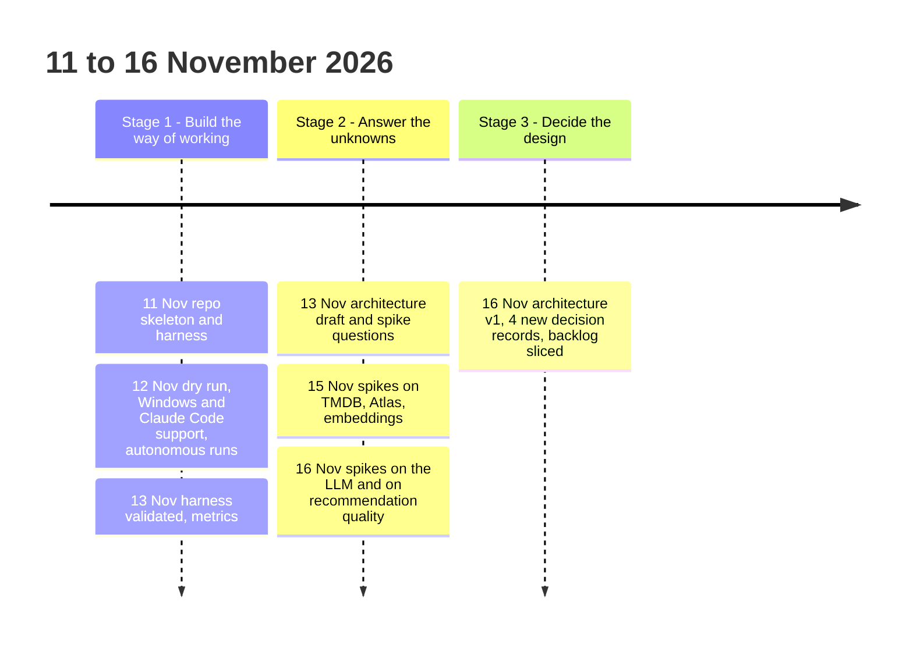

# Part 1 · The big picture

**Reading time:** about 10 minutes · [Back to the index](README.md) · Next: [Part 2 · How we work](02-the-harness.md)

> [!NOTE]
> **Key ideas in this part**
> - The project has two goals: a working product, and proof that you can build AI products in Python.
> - In the first six days we built the way of working (the "harness"), then answered the big unknowns with experiments (the "spikes"), then wrote the design.
> - There is almost no product code yet. That was the plan, not a delay.

---

## 1. What we are building, in one paragraph

You describe how you feel tonight in your own words, for example *"I'm tired and I want something light, maybe a rom-com, but not too dramatic"*. You pick your country (Spain, the United States or Bolivia) and the streaming services you pay for. The app gives you **5 movies you can watch right now on those services**, each with a short "pitch": two or three sentences about the movie itself. It works through a small web page, through an API, and through an MCP server, so an AI assistant can use it as a tool.

Full detail: [the product document](../product.md).

## 2. Why the project exists

The [original brief](../inception/personal-project-brief.md#1-who-this-is-for-and-why) gives three reasons:

1. **Portfolio evidence** for a move to an "applied AI backend engineer" role: a public, deployed, well-built Python project.
2. **Practice in agentic engineering**: agents with goals, loops, gates and roles.
3. **Interview material**: decisions you can defend, real numbers, and stories about what failed.

It also lists the skills you want to close the gap on. This table shows where each one lives in the project, and how much of it we have touched so far.

| Skill to learn | Where it lives in this project | Touched so far? |
|---|---|---|
| Python at production level | `src/`, the tests, the strict type checker, the layer rules | Only the setup and one tiny validator. The spikes have ~6,000 lines of Python, but agents wrote them and they are throwaway. |
| RAG (search + LLM) | Vector search over movie profiles, then an LLM picks and explains | **Designed and tested in spikes**, not built yet |
| Evals (measuring AI quality) | Deterministic checks, golden queries labelled by you, an LLM judge | **Tested in a spike** (we measured how noisy an LLM judge is); the real eval set doesn't exist yet |
| Agents inside a product | The two LLM calls of each search, with typed outputs and retries | **Tested in a spike** with Pydantic AI |
| Agents in loops / in the background | The agents that build the project; later, overnight runs | One task per run, ending in a pull request. Overnight loops not designed yet. |
| Quality gates and hooks | Stop hook, CI, pull-request gate, harness tests | **Built and working** |
| Less human code review | Reviewer agent, deterministic gates, small pull requests | Built; **only tested on documents**, not on real code |

The honest reading of this table: the **harness** part of the curriculum is well practised. The **AI engineering** part (RAG, evals, agents in a product) was explored deeply, but only inside spikes that agents ran. That's why this checkpoint guide spends most of its pages on the spikes.

## 3. The product rules in plain words

The product document has seven rules. Agents must not break them, and each one should end up checked by a test. Here they are without the codes:

1. **Only streamable movies.** Never show a movie that isn't included in a subscription (not rent, not buy) on one of your services in your country, according to the last data refresh.
2. **The pitch talks about the movie, never about you.** No *"because you're tired…"*. Facts from the movie's data only, no spoilers, at most 350 characters. ([Why: decision record 0001](../decisions/0001-pitch-about-movie-not-user.md).)
3. **Your explicit limits are always respected.** If you say "under 90 minutes" or "nothing too intense", breaking that is a failure, not a "slightly worse" result.
4. **The mood text is at most 500 characters.** Longer text is rejected with a message, never cut silently.
5. **Show the data sources** as their terms require (TMDB and JustWatch).
6. **Show how fresh the data is**: every answer says when availability was last updated.
7. **If a rule doesn't say what to do, ask the owner.** An agent must not guess.

Rules 1, 3 and 4 can be checked by code with a yes/no answer. Rule 2 can only be partly checked by code (the length); the rest needs an LLM judge or a human. This difference, "checkable by code" vs "needs judgement", comes back many times in this guide.

## 4. What makes it more than a tutorial

A tutorial would embed movie plots, search by similarity, and ask an LLM to explain. This project adds four things, each a real engineering problem:

- **An "emotional profile" per movie, built offline.** An LLM reads each movie's data once and writes a structured description of how it *feels* to watch: tone, pacing, intensity, ending, content warnings. Search runs over these profiles, not over plot summaries.
- **Hard limits that are guaranteed.** "Nothing too intense" becomes a database filter, not a hope that the LLM will remember.
- **Fresh availability.** A daily job updates which movies are on which service.
- **Evals.** Quality is measured, not claimed.

## 5. The first six days, in three stages

| Stage | What happened | Main outputs |
|---|---|---|
| **1. Build the way of working** (11–13 Nov) | Set up the Python project, the quality checks and the agent harness. Ran a tiny real feature end to end (the 500-character validator) to test the harness. Made the harness work on Windows and in Claude Code, not only on the Mac in Antigravity. | [AGENTS.md](../../AGENTS.md), the skills in `.agents/`, the [stop hook](../../scripts/hooks/stop_gate.py), [CI](../../.github/workflows/ci.yml), [harness tests](../../tests/harness/test_harness.py) |
| **2. Answer the unknowns** (13–16 Nov) | Wrote a first architecture with a list of open questions. Ran five timeboxed experiments ("spikes") to answer them with real data. | Five spike reports in [docs/spikes/](../spikes/) with scripts and raw outputs in [spikes/](../../spikes/) |
| **3. Decide the design** (16 Nov) | Turned the spike results into architecture v1 and four decision records. Cut the rest of the product into thin, ordered slices. | [Architecture v1](../architecture.md), decision records [0005](../decisions/0005-closed-vocabulary-mirror-schema.md) to [0008](../decisions/0008-corpus-gate-and-hybrid-ranking.md), [backlog](../backlog.md) |

## 6. The numbers so far

| Measure | Value |
|---|---|
| Calendar days | 6 (11–16 Nov) |
| Commits | 37 |
| Tasks finished | 15: 9 on the Mac (Antigravity), 6 on Windows (Claude Code) |
| Spikes | 5 (data source, database, embeddings, LLM, recommendation quality) |
| Decision records | 8 |
| Harness incidents logged | 9 |
| Automated tests | 26 (harness tests plus the dry-run validator) |
| Product code | 1 small module ([prompt_validation.py](../../src/watch_tonight/domain/prompt_validation.py)) |
| Throwaway spike code | about 6,000 lines of Python |
| Documentation | about 51,000 words |
| Money spent on LLM calls | about $0.15 (spikes 11 and 16) |

Is "almost no product code after six days" a problem? Compared with the brief's own plan, no: week 1 was "feasibility spike + repo setup", and that's what happened. The real risk is different, and [Part 2](02-the-harness.md) and the [review](review.md) come back to it: most of the harness has only been tested on documents, and the first real code is about to arrive.

## 7. Where we are now, and what comes next

- **Done:** the harness, the five spikes, architecture v1, the backlog.
- **Next, in order:**
  1. Re-measure how fast the streaming catalogue changes (a small follow-up to the recommendation spike; it needs a second snapshot taken at least 24 hours after the first).
  2. **The walking skeleton:** the first time a real search runs end to end, on the ~300 movies from the recommendation spike, in a local database. This is where the design meets reality.
  3. Profile design: finalize the vocabulary of the emotional profile and rate about 30 movies yourself.

Current status is always in [PROGRESS.md](../../PROGRESS.md), and the ordered list is in [feature_list.json](../../feature_list.json) and [the backlog](../backlog.md).

## 8. Three ideas to keep in mind for the rest of the guide

1. **"Checkable by code" beats "checked by an LLM".** The design keeps pushing rules out of the LLM's hands and into code or database filters, because code gives the same answer every time and can be tested.
2. **A number is only as good as how it was measured.** The spikes produced many numbers. Some were measured on real data, some on synthetic data, some were estimates. Part 4 shows how to tell them apart.
3. **Reversible decisions can be made fast; irreversible ones need evidence.** Choosing an embedding model is cheap to change (re-embed in 20 minutes). Choosing what data you are legally allowed to store is not.

---

### Questions to think about

- If you had to explain the product to an interviewer in 30 seconds, what would you say makes it "more than a tutorial"?
- Which of the seven product rules would you find hardest to test automatically? Why?
- Look at the skills table. Which skill do you feel you could explain in an interview today, and which not yet?

[Back to the index](README.md) · Next: [Part 2 · How we work](02-the-harness.md)
