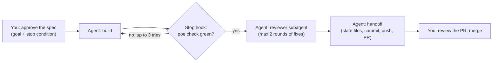

# Part 2 · How we work: the harness

**Reading time:** about 20 minutes · [Back to the index](README.md) · Previous: [Part 1](01-big-picture.md) · Next: [Part 3 · The architecture](03-the-architecture.md)

> [!NOTE]
> **Key ideas in this part**
> - **Agent = model + harness.** The harness is everything around the model that makes its work reliable: instructions, memory files, checks and roles.
> - Gates come in three strengths. Only checks that run *outside* the agent's control are real guarantees.
> - Most harness lessons so far came from small, boring failures: text encodings on Windows, a test that depended on the repo's state, a reviewer looking at the wrong diff.
> - The harness has mostly been exercised on **documents**. Its real test starts with the first product code.

---

## 1. What a "harness" is

A coding agent on its own forgets everything when the chat ends, can claim "done" without proof, and can drift from the rules you gave it an hour ago. A **harness** is the set of files, scripts and checks around the agent that fixes those three problems:

| Problem | What the harness does about it | Where |
|---|---|---|
| The agent forgets between sessions | All state lives in files in the repo, pushed to GitHub | [PROGRESS.md](../../PROGRESS.md), [feature_list.json](../../feature_list.json), `docs/handoffs/` |
| The agent claims success without proof | Automatic checks that block it, and a rule to paste command output as evidence | [Stop hook](../../scripts/hooks/stop_gate.py), [CI](../../.github/workflows/ci.yml), "Definition of Done" in [AGENTS.md](../../AGENTS.md) |
| The agent drifts from the rules | One short instruction file, skills for repeated routines, a separate reviewer | [AGENTS.md](../../AGENTS.md), [.agents/skills/](../../.agents/skills/), [reviewer](../../.agents/agents/reviewer.md) |

The idea comes from the course the harness was built from (learn-harness-engineering). The brief puts it as moving from **human-in-the-loop** (you check every step) to **human-on-the-loop** (you set the goal, decide at a few gates, and improve the harness every time it fails).

> [!TIP]
> **C# comparison.** Think of the harness as the build pipeline plus the team's working agreement. `AGENTS.md` is the "CONTRIBUTING.md" that a new developer reads on day one. The Stop hook is like a pre-push hook that runs `dotnet build && dotnet test`. Branch protection is the same as in Azure DevOps.

## 2. The golden rule: the repository is the memory

You work on two machines with two different AI tools. Chat history stays on the machine where it happened. So the rule is: **anything the next session needs must be in a file, committed and pushed.**

| What needs remembering | File |
|---|---|
| Where are we, what's next, what's blocked | [PROGRESS.md](../../PROGRESS.md) ("Now" section, plus a one-line log) |
| What to work on, in which order | [feature_list.json](../../feature_list.json) (the next 3 items) and [docs/backlog.md](../backlog.md) (the rest) |
| What "done" means for a feature | `docs/specs/NN-name.md` (you approve it) |
| What an experiment found | `docs/spikes/NN-name.md` |
| Why something was decided | `docs/decisions/NNNN-name.md` |
| Proof that a finished task works | `docs/handoffs/<task>.md` |
| When the harness failed, and the fix | [docs/harness-log.md](../harness-log.md) |
| What you learned | [LEARNING.md](../../LEARNING.md) |

In week 1 these files grew fast, so one task (feat-015) split them into a short **index file** plus one **detail file per entry**. A harness test checks that every index line points to a real detail file and every detail file is listed. The reason is practical: an agent reads the index at the start of every session, so the index must stay short.

## 3. The task cycle: who decides what

This is [decision record 0004](../decisions/0004-autonomous-task-runs-owner-gates.md). Before it, there were two "modes" (stepped and autonomous) described only in text. Nothing selected or enforced them, and agents chained steps on their own anyway. So the decision was: **one default flow, and the human decides only at the gates**: approving a spec, merging a pull request, and any question that needs a human (the spec looks wrong, an unknown changes the design, a review finding changes the scope).

The price of this decision is written in the record itself: if agents do everything between the gates, your understanding can drift away from the code ("comprehension rot"). The remedy is `/defend` and `/tutor`, which are now **optional**. That's why this checkpoint exists.

## 4. Three strengths of gate

This is probably the most useful idea in the whole harness. Not every "rule" is equally strong.

| Strength | What it means | Examples in this repo | Can the agent get around it? |
|---|---|---|---|
| **1. Enforced outside the agent** | GitHub or CI runs the check, whatever the agent does | Branch protection on `main`; [CI](../../.github/workflows/ci.yml) runs `poe check`; the [PR gate](../../scripts/ci/pr_gates.py) fails any pull request that touches `tests/acceptance/` or `evals/` unless **you** add the `tests-approved` label | No |
| **2. Enforced by the agent's tool** | The AI tool runs a script when the agent tries to stop | The [Stop hook](../../scripts/hooks/stop_gate.py): if code changed and `poe check` fails, the agent can't end its turn (it gives up after 3 tries and hands back to you) | Only by failing 3 times |
| **3. Written instructions** | The agent reads a rule and (usually) follows it | "Never edit acceptance tests", "paste the evidence", "stay in scope", the reviewer's checklist | Yes: it can forget or misread |

A good habit from this table: **when a rule really matters, move it up a level.** "Agents never edit acceptance tests" started as an instruction (level 3). It became a CI check (level 1) because an agent that writes both the code and its tests can make anything pass.

> [!IMPORTANT]
> The reviewer agent is a **level 3** gate. It is useful, but it is still a model reading files. Part 4 and the [review](review.md) show that on the Mac it reported "no findings" on spikes that did have problems.

## 5. The parts of the harness

| Part | What it does | File |
|---|---|---|
| `AGENTS.md` | The map and the rules. Kept under 150 lines (a test checks it), because it is read at the start of every session. | [AGENTS.md](../../AGENTS.md) |
| `poe check` | One command that runs the linter (ruff), the formatter check, the strict type checker (pyright), the layer rules (import-linter) and the fast tests (pytest). | [pyproject.toml](../../pyproject.toml) `[tool.poe.tasks]` |
| Stop hook | Runs `poe check` when the agent tries to finish a turn that changed code. | [stop_gate.py](../../scripts/hooks/stop_gate.py) |
| Skills | Repeated routines as instructions: `/start`, `/spec`, `/review`, `/handoff`, `/tutor`, `/defend`. | [.agents/skills/](../../.agents/skills/) |
| Reviewer | A separate, read-only agent that compares the branch with the spec. It starts with a fresh context, so it doesn't share the builder's assumptions. | [reviewer.md](../../.agents/agents/reviewer.md) |
| Harness tests | Tests about the harness itself: line limits, task-list rules, index files in sync, the Stop hook's behaviour, the PR gate. | [test_harness.py](../../tests/harness/test_harness.py) |
| pre-commit | Runs gitleaks (secret scanner) and ruff before every commit. | [.pre-commit-config.yaml](../../.pre-commit-config.yaml) |

## 6. Two tools, one source of truth

On the Mac you use Antigravity; on Windows, Claude Code. They read different files:

- Antigravity reads `AGENTS.md` and `.agents/`.
- Claude Code reads `CLAUDE.md` and `.claude/`.

[Decision record 0003](../decisions/0003-support-antigravity-and-claude-code.md) keeps **one** source (`AGENTS.md` and `.agents/`) and makes `.claude/` a set of thin pointers ("read the file in `.agents/` and follow it"). Copies were rejected because they drift. Symlinks were rejected because Git on Windows checks them out as plain text files.

The Stop hook is a nice small example of this. **One script serves both tools**, but each tool expects a different answer:

- Antigravity wants `{"decision": "continue"}` to keep the agent working.
- Claude Code wants `{"decision": "block"}`, and no output at all means "you may stop".

The script reads the incoming message, recognises which tool sent it, and answers in that tool's format. [Part 7](07-inside-the-code.md#1-the-stop-hook-one-script-two-dialects) walks through the code.

## 7. What went wrong, and what we learned

The [harness log](../harness-log.md) has 9 entries. Four of them teach something general:

**a) Text encoding on Windows.** The Stop hook crashed on Windows. Python on Windows reads text with the old "cp1252" code page by default, while git and import-linter print UTF-8. On top of that, Windows PowerShell 5.1 adds an invisible marker (a "BOM") at the start of piped text, which breaks JSON parsing. The fix: always say `encoding="utf-8"`, and read the input as raw bytes decoded with `utf-8-sig` (which drops the BOM).
*Lesson:* .NET defaults to UTF-8 almost everywhere; Python defaults to the operating system's choice. Always name the encoding. ([log entry](../harness-log/2026-11-12-feat-004-windows-stop-hook-encoding.md))

**b) A test that depended on the repo's state.** A Stop-hook test passed on the Mac (where the repo had uncommitted changes) and failed in CI (a clean checkout). The fix: the test now creates a throwaway git repo in a temporary folder.
*Lesson:* a test must create the world it needs. ([log entry](../harness-log/2026-11-12-feat-004-ci-git-state-test.md))

**c) The reviewer looked at the wrong diff.** It compared against `HEAD`, so it missed work the agent had already committed on the branch. The fix: compare against `origin/main`.
*Lesson:* "review the changes" needs a precise definition of "changes". ([log entry](../harness-log/2026-11-12-feat-004-reviewer-diff-target.md))

**d) Rules written in many places drift apart.** The stepped/autonomous modes were described in several skills, slightly differently each time. The fix: one place per rule, and enforce the important ones (decision record 0004).
*Lesson:* one source per rule, and move important rules up to a stronger gate. ([log entry](../harness-log/2026-11-12-feat-004-autonomous-workflow.md))

A fifth one is worth knowing for interviews: the harness was checked with the course's own validator script. It scored 60/100, then 92/100 after real fixes. The log is careful to say what the score means: it checks that the guide's *words* are present, not that the harness *works*. The decision was not to chase 100 by adding keywords. ([log entry](../harness-log/2026-11-13-feat-014-validate-harness.md))

## 8. What the harness has not been tested on yet

This matters for how much you trust it.

- **The Stop hook has never blocked a real failure.** Its two blocks were intentional tests. It only watches `src/`, `web/`, `tests/`, `scripts/` and `pyproject.toml`, and stage 2 changed almost only documents and `spikes/`.
- **The spike scripts are outside every automatic check.** `poe check` lints and type-checks `src`, `tests` and `scripts`, not `spikes/`. That's reasonable for throwaway code, but spike results drove real decisions, so a bug in a spike script becomes a wrong decision. Spike 16 found two of its own bugs this way (a de-duplication function that was never called, and a depth test that left out one ranking term).
- **The reviewer has reviewed real code only once** (the tiny validator). Its checklist is about code: unmet acceptance tests, bugs, missing tests, layer violations. It has no checklist for spikes: "does every number match the raw output?", "is the conclusion bigger than the evidence?".
- **The protected-tests gate has never fired**, because no acceptance tests have been written since the dry run.

None of this is a mistake. It means the harness's real exam is the walking skeleton.

---

### Questions to think about

- Pick one rule in `AGENTS.md` that is only an instruction today. What would it take to make it a level 1 or level 2 gate? Is it worth it?
- The Stop hook gives up after 3 failed attempts. Why not block forever? What could go wrong either way?
- Why must the reviewer be a separate agent with a fresh context, instead of asking the builder "please review your own work"?
- Decision record 0004 accepts the risk of "comprehension rot". How would you notice it happening to you?

[Back to the index](README.md) · Previous: [Part 1](01-big-picture.md) · Next: [Part 3 · The architecture](03-the-architecture.md)
