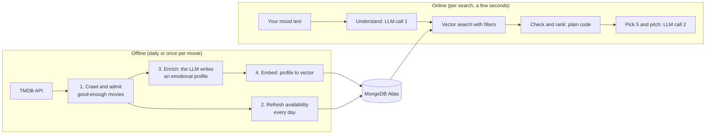
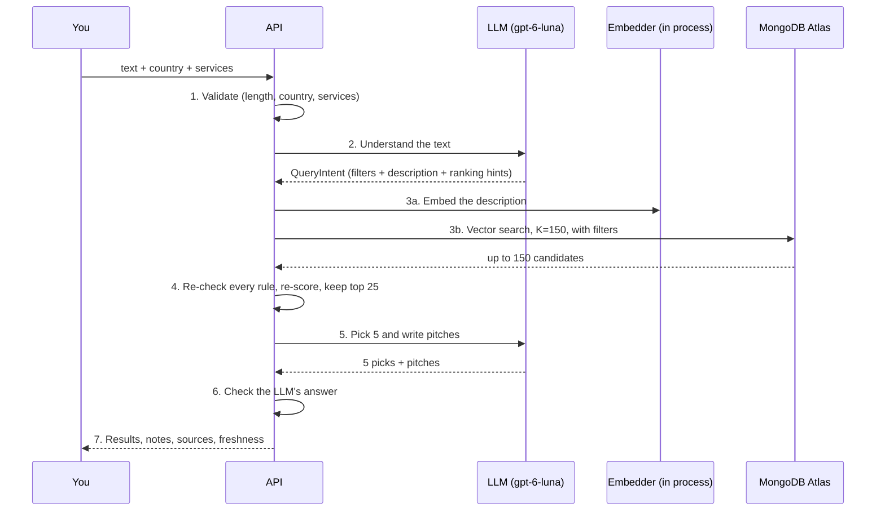

# Part 3 · How the product will work: the architecture

**Reading time:** about 20 minutes · [Back to the index](README.md) · Previous: [Part 2](02-the-harness.md) · Next: [Part 4 · Spikes on the foundations](04-spikes-foundations.md)

> [!NOTE]
> **Key ideas in this part**
> - The system has two halves: **offline** jobs prepare the data (slow, once or daily), and the **online** search answers in a few seconds.
> - An online search is 7 steps with **2 LLM calls**. Between the two calls, plain code checks every hard rule.
> - The LLM never decides whether a movie is "OK for kids" or "under 90 minutes". It only **translates** your words into fields; the database and the code apply them.
> - Every external service sits behind an interface ("port"), so it can be replaced and faked in tests.

The full document is [docs/architecture.md](../architecture.md). This part explains it in a different order: first the shape, then one search followed step by step, then the decisions.

---

## 1. Two halves: prepare offline, answer online

**The basic trade-off:** anything slow or expensive happens once, before anyone searches. The online path only does what depends on your request.



### The offline jobs

1. **Crawl and admit.** Every day, ask TMDB for all movies on a subscription service in Spain, the US and Bolivia. A movie we haven't stored yet is **admitted** only if it passes a quality gate (called "G7"; [Part 6](06-spike-recommendation-quality.md) explains it). That keeps about 14,500 of 51,500 movies.
2. **Refresh availability.** Every day, update which services each stored movie is on. This is what keeps the "only streamable movies" rule true.
3. **Enrich.** For each newly admitted movie, the LLM reads its TMDB data (overview, genres, keywords, credits) **once** and writes a structured **emotional profile**: tone, pacing, intensity (1 to 5), viewing effort, the feeling of the ending, humour style, content warnings, themes, and a short summary of how it feels to watch. This uses OpenAI's Batch API, which costs half price in exchange for waiting up to 24 hours.
4. **Embed.** Turn each profile into a list of 384 numbers (a "vector") that captures its meaning. Movies with similar feelings get similar vectors.

### Why profiles, and not plot summaries?

A plot summary says *what happens* ("A man moves to a coastal town after a loss"). It doesn't say *how it feels* ("slow, quietly devastating, cathartic"). Your request is about feelings. So the search runs on the profile, which describes feelings. The recommendation spike measured this: searching over profiles beat searching over TMDB text (more in [Part 6](06-spike-recommendation-quality.md)).

## 2. One search, step by step

Let's follow one request:

> *"Movie night with my kids, something light and funny, under 90 minutes, no spiders please."*
> Country: Spain. Services: Netflix and Disney+.



**Step 1 · Validate.** Is the text 1–500 characters? Is Spain supported? Are Netflix and Disney+ known services in Spain? If not, you get an "invalid input" message. No LLM is involved.

**Step 2 · Understand (LLM call 1).** The LLM turns your words into a typed object called `QueryIntent`. It has **three channels**:

| Channel | Purpose | From our example |
|---|---|---|
| **Hard filters** | Rules that must never be broken | `audience = kids`, `max_runtime_minutes = 90` |
| **Meaning** | What to search for | `tone = [light, funny]`, and an English `semantic_description` such as *"A light, funny family comedy with gentle humour and low stakes."* |
| **Ranking hints** | How to sort | `specificity = broad` (many movies fit), `era_mode = modern_default` |

Plus a fourth list: **`unmapped_constraints`**. "No spiders" can't be expressed with the fixed list of content warnings, so the LLM must **not** squeeze it into a nearby value (like "horror"). It goes into this list, and the answer will say *"We couldn't apply: no spiders"*. That is honest and testable.

If the text is in Spanish or Japanese, the `semantic_description` is still written in English, because the movie profiles are in English.

**Step 3 · Retrieve.** Embed the `semantic_description` into a vector. Ask MongoDB for the **150 nearest movies** whose fields pass the filters: streamable on `ES:8` (Netflix) or `ES:337` (Disney+), runtime ≤ 90, not already shown to you, and the kids rule. The database applies the filters **before** it ranks by similarity ("pre-filtering"), so all 150 already obey the rules.

**Step 4 · Check and rank (plain code, no LLM).**
- Check every rule again by value. Never trust a single layer for a rule that must not break.
- Re-score each candidate with a formula: similarity, plus quality, plus era, plus popularity, with weights that depend on how specific your request was. (Broad request → quality and popularity matter more. Specific request → similarity dominates.)
- Keep one movie per franchise, and pass the top 25 to step 5.

**Step 5 · Pick and pitch (LLM call 2).** The LLM sees the 25 candidates (their data and profiles) and your intent. It picks 5 and writes a pitch for each: about the movie, never about you, at most 350 characters.

**Step 6 · Check the LLM's answer (plain code).** Is every picked ID one of the 25? No duplicates? Exactly 5 picks (or fewer if there were fewer candidates)? Every pitch ≤ 350 characters? If not, retry **once**, sending the error back to the LLM. If it still fails, return the top 5 by score **without pitches**, with a note.

**Step 7 · Respond.** Title, year, runtime, poster, services, pitch, TMDB link, and the date of the last availability refresh. Plus the sources' attribution, any notes ("We couldn't apply: no spiders"), and a `trace` with timings, tokens and cost.

### Why two LLM calls and not one?

One call could read your text *and* pick from candidates. But then the LLM would see candidates **before** the code has removed those that break your rules. Step 4 must sit between "understand" and "pick", so there are two calls. ([Spike 11](../spikes/11-runtime-llm.md#4-latency) found this too: when the picking step didn't see the "avoid" filters, Gemini picked *Scary Movie* for "nada de violencia".)

### What happens when things fail

| What fails | What you see |
|---|---|
| Your input breaks a limit | "Invalid input", with the field at fault |
| LLM call 1 fails (down, out of quota, or invalid twice) | "Service unavailable, try later". Without understanding the text, there is nothing honest to search for. |
| Fewer than 5 movies pass the rules | "Partial": the ones that pass, plus a tip (add a service, relax a limit) |
| LLM call 2 fails | "Results without pitches": the top 5 by score, no pitches, with a note |

The principle: **never fail silently and never invent results.**

## 3. Layers and ports (the Clean Architecture part)

The code is split into layers, and a tool (import-linter) fails the build if a layer imports the wrong thing:

```
domain   ←   application   ←   infra, api, mcp_server, jobs
(rules,      (use cases,        (TMDB client, MongoDB, LLM, embedder;
 ports)       e.g. SearchMovies)  HTTP API; MCP server; daily jobs)
```

> [!TIP]
> **C# comparison.** `domain` is your Core project with the interfaces. `application` holds the use-case services. `infra` holds the implementations (repositories, HTTP clients). `api`, `mcp_server` and `jobs` are composition roots, like `Program.cs` in an ASP.NET Core app and a worker service. Python's `Protocol` plays the role of a C# `interface`, with one difference: a class satisfies a `Protocol` just by having the right methods ("structural typing"); it never declares `: IMovieRepository`.

The **ports** (interfaces) are:

| Port | Real implementation | Why it's behind a port |
|---|---|---|
| `MovieSource` | TMDB client | Rate limits, retries; fake it in tests |
| `QualitySignals` | Wikidata (critic scores, awards) | An optional signal; may be missing |
| `MovieRepository` | MongoDB (`pymongo` async client) | Swap or fake the database |
| `CandidateSearch` | Atlas `$vectorSearch` | The one database-specific query |
| `LanguageModel` | OpenAI `gpt-6-luna` through Pydantic AI | Swap provider or model; fake it in tests |
| `Embedder` | `fastembed` with the `bge-small-en-v1.5` model | Swap model; fake it in tests |

The API and the MCP server both call the **same** use case (`SearchMovies`), so they return the same results. That's how the MCP user story is satisfied almost for free.

## 4. One movie in the database

A simplified movie document (full version in [architecture §5](../architecture.md#5-data-model-mongodb-v1)):

```jsonc
{
  "_id": 603, "title": "The Matrix", "year": 1999, "runtime": 136,
  "original_language": "en", "certification_us": "R", "certification_es": "18",
  "quality_score": 8.1,                  // Bayesian average of TMDB votes (Part 7 explains)
  "streamable": ["ES:8", "US:8"],        // "country:service", subscription only
  "availability_updated_at": "2026-11-16T03:00:00Z",
  "profile": {
    "tone": ["dark", "tense"], "pacing": "fast", "intensity": 4,
    "viewing_effort": "engaging", "ending_feel": "tense_cathartic",
    "content_warnings": ["violence"], "themes": ["identity", "control"],
    "summary": "… how it feels to watch …"
  },
  "embedding": [/* 384 numbers */], "embedding_model": "BAAI/bge-small-en-v1.5",
  "prompt_version": "p1", "source_hash": "…"
}
```

Three design details worth noticing:

- **`streamable` is a flat list of strings** like `"ES:8"`. A vector-search filter works best on a simple field, and one string holds both the country and the service.
- **`source_hash` + `prompt_version` + `embedding_model`** make the jobs **idempotent**: a job re-runs on a movie only when its input data, the prompt or the model changed. Running the job twice changes nothing the second time. (You know this pattern from message handlers in Service Bus.)
- **Movies that leave streaming are kept** with `streamable: []`. Their profile and vector are already paid for, so if they come back, they're searchable again at no cost.

## 5. The decisions, one line each

| Record | Decision | Main reason | The price |
|---|---|---|---|
| [0001](../decisions/0001-pitch-about-movie-not-user.md) | Pitches describe the movie, never you | "Because you're tired…" feels patronising | Pitch quality is harder to judge automatically |
| [0002](../decisions/0002-full-harness-upfront-with-stepped-mode.md) | Build the full harness before the product | Have the tutor, reviewer and gates from the first task | Several days before any product code |
| [0003](../decisions/0003-support-antigravity-and-claude-code.md) | One harness, two AI tools | Antigravity's limits were too tight for daily work | Every harness change must work in both |
| [0004](../decisions/0004-autonomous-task-runs-owner-gates.md) | Agents run a ready task end to end; you decide at gates | Less friction; the gates make it safe | Risk of losing track of the code |
| [0005](../decisions/0005-closed-vocabulary-mirror-schema.md) | Constraints use a fixed vocabulary that mirrors the stored fields | A database filter gives the same answer every time; an LLM doesn't | New kinds of constraint need changes in 3 places |
| [0006](../decisions/0006-runtime-llm-openai-pydantic-ai.md) | OpenAI `gpt-6-luna` through Pydantic AI; no second provider | Most accurate and cheapest; Gemini's free tier can't serve EU users | A small usage cost; an OpenAI outage means degraded answers |
| [0007](../decisions/0007-embeddings-fastembed-profile-template.md) | Small local embedding model; movies embed their profile | Free, fast, no network call | English-only vectors; needs ~512 MB of RAM |
| [0008](../decisions/0008-corpus-gate-and-hybrid-ranking.md) | Admit movies through gate G7; re-score candidates with a formula | Pure similarity can't tell a forgotten TV movie from a classic | The formula's weights are hand-set for now |

## 6. What is still open

- **Does the local database image run vector search on Windows?** It ran on the Mac. The walking skeleton will tell.
- **How fast is a full search?** The two LLM calls alone take about 6.3 seconds at p95 (95% of calls are faster than this) from your laptop. The real number must be measured end to end and from the hosting region.
- **How fast does the catalogue change?** It decides the refresh and admission schedule. The next small task measures it.

And one that the architecture marks as decided, but this checkpoint suggests correcting: **how long TMDB data may be stored** (6 months at most, so the ingest must re-fetch metadata on a schedule). See the [review, finding 1](review.md#finding-1-the-tmdb-spike-took-its-storage-rule-from-the-wrong-source).

---

### Questions to think about

- In step 4 the code re-checks rules that the database already applied in step 3. Is that waste or good design? What would you do in a C# system?
- Why is "no spiders" put in a separate list instead of mapped to `horror_scares`? What would go wrong if the LLM mapped it?
- The "Service unavailable" state is used when call 1 fails, but call 2 failing still returns results. Why the difference?
- Which port would you fake first in a unit test of `SearchMovies`, and what would the fake return?

[Back to the index](README.md) · Previous: [Part 2](02-the-harness.md) · Next: [Part 4 · Spikes on the foundations](04-spikes-foundations.md)
