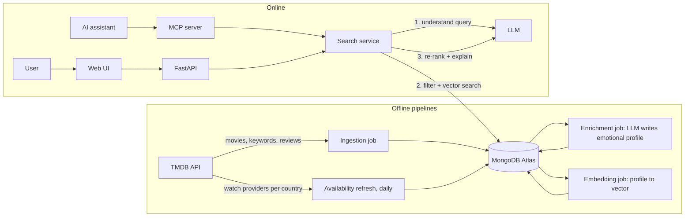

# Personal project brief: "What should I watch tonight?"

> **Historical (inception, Nov 2026). Don't act on it.** Superseded by `docs/product.md` (product), `AGENTS.md` and `docs/workflow.md` (harness), and `docs/decisions/` (e.g. pitch instead of "reason": 0001; Antigravity *and* Claude Code: 0003). Where this file disagrees with them, they win. Its architecture, stack and evals sections (6, 7, 11) are input for `docs/architecture.md` (feat-005).

**Purpose of this document.** It is a hand-off: it should let you, or any AI assistant, continue planning and building the personal project without the original conversation.

It records:
- why the project exists
- what was decided and what is still open
- the proposed product, architecture, stack and harness
- the plan

**Last updated:** 10 Nov 2026. **Status:** idea agreed; design not yet refined; no code yet. **Harness and cross-machine workflow:** see `harness-workflow.md`, which replaces the workflow in section 8 and proposes an answer to Q1 (Q2 is decided: Antigravity).

> **For an AI assistant reading this:** read sections 1–3 first. The owner wants to *learn* Python and agentic engineering through this project, not just get it built. Explain your decisions, prefer small steps, and never treat the open questions (section 14) as settled.
>
> **Facts that may be out of date:** anything about third-party APIs, terms of use or free tiers was written from knowledge as of mid-2026 and is marked **(verify)**. Check it in the Week 1 spike before relying on it.

---

## Contents

1. [Who this is for and why](#1-who-this-is-for-and-why)
2. [Requirements set by the owner](#2-requirements-set-by-the-owner)
3. [Decisions so far](#3-decisions-so-far)
4. [Ideas considered](#4-ideas-considered)
5. [The product](#5-the-product)
6. [Architecture](#6-architecture)
7. [Stack](#7-stack)
8. [The agentic harness used to build it](#8-the-agentic-harness-used-to-build-it)
9. [The learning tutor](#9-the-learning-tutor)
10. [Reducing the human review bottleneck](#10-reducing-the-human-review-bottleneck)
11. [Evals](#11-evals)
12. [Plan](#12-plan)
13. [Risks and legal notes](#13-risks-and-legal-notes)
14. [Open questions](#14-open-questions)
15. [Showcasing it](#15-showcasing-it)
16. [How to resume in a new session](#16-how-to-resume-in-a-new-session)

---

## 1. Who this is for and why

### The owner

| Topic | Detail |
|---|---|
| Profile | Senior backend engineer, 7+ years. C#/.NET and Azure; event-driven microservices (Service Bus, Sagas, outbox); legacy .NET modernization; production root-cause analysis. |
| AI experience | Heavy daily user of AI coding agents (Claude Code, Copilot, Gemini, others). Built 2 MCP servers (one TypeScript, one customer-facing in .NET with the official MCP C# SDK). Built a planner → developer → independent QA multi-agent workflow for Claude Code at work. Strong at prompting and context engineering. |
| Gaps to close | **Python at production level**, **RAG**, **evals**, building agents into a product, running agents in loops and in the background, quality gates and hooks, and reducing human code review. |
| Career direction | "Applied AI backend engineer": backend depth plus building AI agents and integrations. Targeting remote roles with US small and medium companies, working from Bolivia (UTC−4). |
| Time available | **30–90 minutes a day.** |
| Location | Barcelona now. Moving to Bolivia for an 11-week stay soon. |
| Tools | **Google Antigravity** for this project (personal Google account; Google One AI Pro subscription). Installed on the personal machine first; the work laptop is set up later, in a separate session. |

### Why this project

1. **Portfolio evidence.** About 60–67% of AI engineer and forward-deployed engineer postings ask for Python, and many ask for evals, RAG and agents. A public, deployed, well-engineered Python project is the most direct proof. It also gives the CV's "Python (scripting)" an honest upgrade path.
2. **Practice in agentic engineering.** Goals, loops, multi-agent roles, hooks, quality gates and background agents, in a setting where everything can be public.
3. **Interview material.** Design decisions you can defend, eval numbers, cost per query, and stories about what failed and how the harness was improved.

---

## 2. Requirements set by the owner

| # | Requirement | Notes |
|---|---|---|
| R1 | **AI must be involved**, ideally a full agentic harness | Goals, quality gates, multi-agent workflows, hooks. |
| R2 | **Python backend plus a UI** | Python is what AI roles ask for, and new AI tools ship there first. With AI help, catching up on the language should be fast; engineering principles carry over. The UI is a requirement, not optional: React or any other common frontend framework (TypeScript preferred). Keep it thin. |
| R3 | **Non-relational database** | The owner has worked with SQL extensively and wants something different. |
| R4 | **Narrow scope** | The owner must stay attentive and be able to **defend every decision** in an unfamiliar language and framework. Slow is fine; vibe coding is not. |
| R5 | **A learning tutor or supervisor** | A separate AI role whose goal is that the owner *learns*: it highlights what's happening in the code, framework and language. This is different from the agents that implement features. |
| R6 | **Special focus on supporting human code review** | The owner sees review as the main bottleneck of agentic development. |
| R7 | **Public** | GitHub repo, shown in interviews and on the CV and LinkedIn. |

---

## 3. Decisions so far

| Topic | Decision | Status |
|---|---|---|
| Domain | **Movies** (music only as a later version) | Agreed |
| Core task | One specific task: free-text situation or mood, plus streaming services and country, returns **5 movies available now, each with a reason** | Agreed; details open |
| Language | Python backend | Agreed |
| UI | **Required** (not optional): React or another common frontend framework | Agreed; framework open |
| Database | MongoDB Atlas, with built-in vector search | Proposed |
| AI coding tool | **Antigravity** (personal Google account); installed on the work laptop later, in a separate session | Agreed |
| Harness | Built new for this project | Direction agreed; design open |
| Tutor | A separate role from the implementing agents | Agreed in principle; design open |
| Visibility | Public GitHub repo | Agreed |
| Working name | `watch-tonight` | Placeholder |

---

## 4. Ideas considered

### Data feasibility: the deciding factor (verify all of this in Week 1)

| Question | Movies | Music by mood or feeling |
|---|---|---|
| Catalogue and metadata | **TMDB API**: free for non-commercial use with attribution. Plots, keywords, genres, credits, user reviews. **(verify)** | **MusicBrainz** (open data); **Last.fm API** with crowd tags including moods ("melancholic", "uplifting"), non-commercial **(verify)** |
| Where it's available | **TMDB "watch providers"** per country, with data from JustWatch; JustWatch attribution is required **(verify)**. Netflix and JustWatch have no public API. Paid alternatives: Watchmode, Streaming Availability API **(verify)** | Not applicable |
| Content to interpret | Plots, keywords and reviews can be processed | **Lyrics are copyrighted.** Musixmatch's free plan returns about 30% of a lyric, Genius's API returns none, and storing lyrics in a public product is a legal risk. **Spotify removed audio features, audio analysis and recommendations for new apps in Nov 2024 (verify).** AcousticBrainz stopped in 2022 and left only data dumps. |
| Evaluation | Availability can be checked exactly; mood fit can be labelled and judged | Almost entirely subjective |
| Verdict | **Feasible** | **A research problem.** Possible later as a v2 using Last.fm mood tags, with no lyrics. |

**The owner's own experience with music confirms this.** Lyrics are ambiguous, LLM interpretations are biased, and fetching lyrics through an LLM is inefficient.

### Other ideas noted for later

- **Group movie night:** each person gives a mood and their services, and the system finds a common pick. This would be a natural multi-agent feature in the product.
- **Cross-domain:** "a movie that feels like this song" (needs the music v2).

---

## 5. The product

### Problem statement

Choosing a movie is hard because recommendations are built around genres and popularity, not around how you feel tonight. Even when you find something, it often isn't on the services you pay for in your country.

### The one task (MVP)

> Describe your situation or mood in your own words, for example *"long week, I want something hopeful but not cheesy, under 2 hours"*. Pick your country and streaming services. Get **5 movies you can watch right now**, each with a short reason grounded in the movie's data. This happens in a thin web UI (and through the API and MCP).

### What makes it more than a tutorial

1. **Offline enrichment into an "emotional profile."** A free LLM reads each movie's plot, keywords and a few reviews **once**. It writes a structured profile: tone, pacing, intensity, emotional arc, themes, situations it suits, and content warnings, with the evidence used. This answers the bias problem: the profile is built from evidence, stored, versioned and **evaluated**, rather than invented by a model at query time.
2. **Hybrid retrieval.** Hard filters (country, service, runtime) are combined with vector search over the profiles, then an LLM re-ranks the results and writes the reasons. That is RAG.
3. **Fresh availability.** A daily refresh of what's streamable where. This is idempotent ingestion, the owner's backend strength, in a new stack.
4. **Evals in CI** (section 11).
5. **An MCP server** so AI assistants can use the service as a tool.

### User stories (MVP)

| ID | Story | Acceptance (draft) |
|---|---|---|
| US1 | As a user I describe my mood and pick country + services in the UI, and get 5 movies | Every result is streamable (flat-rate) on a selected service in that country as of the last refresh; each has a reason of 1–2 sentences |
| US2 | I can add constraints such as max runtime or "nothing too intense" | Constraints are respected; violations count as eval failures |
| US3 | I can ask again excluding what I've already seen in this session | No repeated results |
| US4 | An AI assistant can call it through MCP | Tools return structured results with links and attribution |

### Out of scope for the MVP

User accounts and personal history, TV series, music, social features, paid APIs, mobile apps, and a polished UI (the UI is in scope but stays thin).

### Definition of done for the MVP

- Deployed URL (with a working UI) and public repo.
- README with an architecture diagram, setup, **eval results**, **cost per query** and design decisions.
- Eval suite running in CI.
- MCP server documented.
- 3-minute demo video.
- `LEARNING.md` showing what was learned.

### Future improvements

- **"Movies you like":** let the user provide movies they like, to improve the recommendations (for example, blending the emotional profiles of those movies into the query). Not in the MVP; it needs some form of per-user input, which is out of scope for now.

---

## 6. Architecture

### Components



### Query flow

1. **Parse the request:** `{text, country, providers[], max_runtime?, exclude_ids[]}`.
2. **Understand the query:** the LLM returns a typed intent (Pydantic model): desired tone, things to avoid, themes, a situation summary and any extra constraints.
3. **Retrieve candidates:** MongoDB `$vectorSearch` on the profile embedding with a **pre-filter** on availability and runtime. Take the top 30–50.
4. **Re-rank and explain:** the LLM picks 5 and writes reasons that cite profile evidence.
5. **Guardrails:**
   - every returned ID must be one of the candidates (no invented titles)
   - availability is re-checked
   - the output is schema-validated
6. **Respond:** results, TMDB/JustWatch attribution, and a trace (timings, tokens, cost).

### Data model sketch (MongoDB, to refine)

```jsonc
// collection: movies   (_id = TMDB id)
{
  "_id": 603,
  "title": "The Matrix", "year": 1999, "runtime": 136,
  "genres": ["Action", "Science Fiction"],
  "keywords": ["simulated reality", "chosen one"],
  "overview": "…",
  "credits": { "directors": ["…"], "cast": ["…"] },
  "review_snippets": ["…"],              // short excerpts only (verify TMDB terms)
  "streamable": ["ES:8", "US:8", "BO:119"],  // country:provider (flat-rate), flattened for the vector-search pre-filter
  "availability_updated_at": "2026-11-09T03:00:00Z",
  "profile": {
    "tone": ["dark", "cerebral"], "pacing": "fast", "intensity": 4,
    "emotional_arc": "confusion → awakening → empowerment",
    "themes": ["identity", "control"], "good_for": ["want to think", "adrenaline"],
    "content_warnings": ["violence"], "summary": "…",
    "evidence": ["overview", "keyword:simulated reality", "review:2"],
    "model": "…", "prompt_version": "p1", "created_at": "…"
  },
  "embedding": [/* 384 floats */], "embedding_model": "bge-small-en-v1.5",
  "source_hash": "…",                     // re-enrich only when inputs change (idempotency)
  "updated_at": "…"
}
// also: providers, ingestion_runs (audit and metrics), eval_runs
```

**Design notes:**
- `streamable` is flattened (`"country:provider"`) because vector-search pre-filters work best on simple indexed fields **(verify with Atlas)**.
- `source_hash` plus `prompt_version` make enrichment idempotent and re-runnable when the prompt changes. The owner already knows these patterns from Service Bus work.
- Corpus size: start with about 5–20k popular movies that have a streaming provider in the target countries. Watch the Atlas free-tier storage limit **(verify)**.

### Code structure (Clean Architecture, which the owner knows from .NET)

```
src/watch_tonight/
  domain/        # entities, value objects, ports (Protocols): no I/O
  application/   # use cases: search, enrich, refresh
  infra/         # tmdb client, mongo repositories, llm client, embeddings
  api/           # FastAPI routes
  mcp_server/    # MCP tools
  jobs/          # ingestion, availability, enrichment, embedding entry points
web/             # frontend (React or similar), talks to the API
```

`import-linter` enforces the layers: `domain` imports nothing else; `infra` and `api` depend inward.

---

## 7. Stack

| Layer | Proposed | Why | Alternatives |
|---|---|---|---|
| Language and tooling | Python 3.13, **uv** (packages), **ruff** (lint and format), **pyright** (types) | Current standard tooling; types give C#-like safety | Poetry, mypy |
| API | **FastAPI** + **Pydantic** | Most common Python API stack; Pydantic is close to C# records with validation | Litestar |
| Database | **MongoDB Atlas** free tier with **Atlas Vector Search** | Non-relational (R3); documents fit movie profiles; vector search built in; some prior MongoDB exposure | Qdrant or Chroma plus a document DB; Firestore |
| Local DB for tests | **`mongodb/mongodb-atlas-local`** Docker image, which includes vector search **(verify)** | Integration tests without the cloud | Testcontainers with that image |
| Embeddings | **sentence-transformers** run locally (e.g. `bge-small-en-v1.5`, 384 dimensions) | Free and offline; fast enough on a CPU for 20k items | Gemini embeddings API |
| LLM (product runtime) | **Gemini API free tier** with a Google AI Studio key **(verify limits)** | Free; fits the Google subscription. Free tiers may use data for training, which is fine because the data is public | Groq free tier, OpenRouter free models, local Ollama |
| Agent framework (query step) | **Pydantic AI** (typed, native Gemini support) **(verify)** | Small and type-safe, close to the C# mindset | OpenAI Agents SDK; LangGraph if the flow needs state or approvals (most named in job ads); Google ADK |
| MCP | Official **MCP Python SDK** (FastMCP) | The owner's strength, now in Python | — |
| HTTP and resilience | **httpx** (async) + **tenacity** (retries) | Like `HttpClient` + Polly | — |
| Tests | **pytest**, pytest-asyncio, **mutmut** (mutation testing) | Standard Python testing | Hypothesis for property tests |
| Evals | Own runner with pytest-style reports; optional **Langfuse** for traces | Keep it simple first | promptfoo, DeepEval |
| CI/CD | **GitHub Actions** | Public repo; also enables GitHub-based background agents | — |
| Deploy | **Azure Container Apps** (known) or **Fly.io / Render** free tiers **(verify)** | Cheap or free hosting | Google Cloud Run (fits Gemini) |
| UI | **React** + TypeScript + Vite (or another common framework such as Next.js, Vue or Svelte), in `web/`; **eslint**, **tsc** and **vitest** in the checks | Required (R2); thin, so scope stays narrow (R4) | Next.js; Streamlit only as a throwaway prototype |

### C# → Python map (starting point for the tutor)

| C# / .NET | Python equivalent |
|---|---|
| `dotnet` CLI, NuGet, `.csproj` | `uv`, PyPI, `pyproject.toml` |
| Records + DataAnnotations / FluentValidation | Pydantic models |
| Interfaces | `Protocol` (structural typing) or `ABC` |
| ASP.NET Core DI | FastAPI `Depends` |
| `async`/`await`, `Task` | `async`/`await`, coroutines, one event loop (`asyncio`) |
| `HttpClient` + Polly | `httpx` + `tenacity` |
| xUnit fixtures, `[Theory]` | pytest fixtures, `@pytest.mark.parametrize` |
| Nullable reference types, analyzers | Type hints + pyright (strict), ruff rules |
| `IOptions<T>` configuration | `pydantic-settings` |
| NetArchTest | import-linter |
| Stryker.NET | mutmut |
| LINQ | Comprehensions, `itertools`, generators |

---

## 8. The agentic harness used to build it

Agent = model + harness. The aim is to move from **human-in-the-loop** (reviewing every step) to **human-on-the-loop** (improving the harness each time it fails). The detailed design (two-machine workflow, levels, templates) is in `harness-workflow.md`.

### Principle: keep the gates deterministic and in the repo

The tool is **Antigravity**. Even so, put the source of truth in plain files in the repo so that quality checks never depend on the agent's goodwill:

| Concern | Source of truth | Antigravity adapter **(verify features)** |
|---|---|---|
| Project instructions | `AGENTS.md` | Read automatically by Antigravity |
| Quality checks | `uv run poe check` running ruff, pyright, import-linter, pytest and the UI checks; **pre-commit hooks**; **CI** | Stop hook: `poe check` must pass |
| Agent roles | `.agents/agents/*.md` (reviewer) and `.agents/skills/*` (`/start`, `/handoff`, `/spec`, `/defend`) | Antigravity subagents and skills |
| Background runs | GitHub issues → PRs | Antigravity CLI headless mode, **Jules** (Google's asynchronous coding agent) **(verify)** |
| Universal background option | **GitHub Copilot coding agent** (assign an issue, get a PR) | — |

### Lightweight workflow

```
Slice spec (1 page, written by you with AI interviewing you) ──▶ you approve
   ──▶ Implementer agent (code + tests, gated by `make check`)
   ──▶ Reviewer agent (read-only, diff vs spec, correctness only)
   ──▶ Tutor (learning entry + "defend it" questions)
   ──▶ you answer, review by risk tier, merge
```

- **Slice spec** (`docs/specs/NN-slug.md`): goal, acceptance tests, out of scope, open questions. One page at most. *Specs stay short and exist mainly so agents can run unattended.*
- **Acceptance tests first.** You write or approve them. A hook or CI check blocks agents from editing `tests/acceptance/` and `evals/` during implementation.
- **Roles:**
  - **Implementer:** builds the slice and its tests.
  - **Reviewer:** read-only; checks the diff against the spec for correctness only.
  - **Tutor:** learning, see section 9.
  - **Evaluator** (optional): runs the evals and reports.
- **Loops to practise:**
  - a goal condition ("`make check` passes and the acceptance tests in X pass, or stop after N turns")
  - a **Ralph loop** (a fresh session per item, progress kept in a file and git) for pipeline work
  - parallel worktrees for independent tasks
  - **overnight runs** with a post-mortem
- **Budgets:** turn and cost limits on every unattended run, and cost recorded per merged PR.

### Quality gates

| Gate | Tool | When |
|---|---|---|
| Format and lint | ruff | After each edit (hook) and pre-commit |
| Types | pyright (strict on `domain` and `application`) | Stop hook, CI |
| Architecture rules | import-linter | Stop hook, CI |
| Unit and integration tests | pytest (+ Atlas Local container) | Stop hook (unit), CI (all) |
| UI lint, types and tests | eslint, tsc, vitest | Stop hook, CI |
| Weak-test detection | mutmut on changed modules | CI nightly |
| Secrets | gitleaks | Pre-commit, CI |
| Evals | `make eval` (section 11) | CI on prompt, model and search changes; nightly |
| LLM review | Reviewer agent | After the deterministic gates pass |

---

## 9. The learning tutor

**Goal:** make sure the owner *learns* and can **defend every decision**. Implementing features is not its job. It is a separate role from the implementing agents.

| Mechanism | What it does | How it's enforced |
|---|---|---|
| **Learning entry** | After each merged change, adds to `LEARNING.md`: the Python, FastAPI or MongoDB concepts used, the C# equivalent, why it was done this way, alternatives rejected, pitfalls, and doc links | Tutor role prompt; can run in CI on merge or by command (`/learn` or equivalent) |
| **"Defend it" gate** | Before merging, the tutor asks 3 "why" questions about the diff. You answer them in the PR description. If you can't answer, you don't merge | PR template section; a **deterministic CI check that the section is filled in** |
| **Weekly quiz** | 10 questions built from `LEARNING.md`, with emphasis on topics you got wrong before | Calendar habit; tutor command |
| **Concept map** | A running list of concepts: seen, practised, can explain | Section at the top of `LEARNING.md` |
| **Design decision records** | Every significant choice gets a short decision record in `docs/decisions/` written in your words | Reviewer checks that a decision record exists for flagged changes |

The tutor should **ask before it tells**: Socratic first, then the explanation. Research supports this. In Anthropic's 2026 study, people who generated code and then asked why it works kept 86% understanding, against under 40% for those who only delegated.

---

## 10. Reducing the human review bottleneck

| Mechanism | What it does |
|---|---|
| **Risk tiers by path** | `.github/labeler.yml` labels PRs automatically and CODEOWNERS requires you for high-risk paths. **Human review:** data model, prompts, eval queries and labels, external API clients, auth and config, the tests themselves. **Auto-merge after gates:** formatting, docs, test additions, internal refactors that keep the mutation score. |
| **Review guide per PR** | A GitHub Action (LLM) comments with: risk tier, what the gates already proved (with links), the 2–3 places worth human attention, and open questions. |
| **Small PRs** | One slice item per PR. |
| **Evidence, not claims** | Agents must paste the command and output that proves each claim. |
| **Measure it** | Track **review minutes per PR**, human comments per PR and escaped defects in `docs/metrics.md`. A line like "I reduced my review time from X to Y" is a strong interview story. |
| **Review policy** | `docs/REVIEW_POLICY.md` explains the tiers, so reviewers (and interviewers) can see the reasoning. |

---

## 11. Evals

| Type | What is measured | Target (draft) |
|---|---|---|
| **Deterministic** (must be 100%) | Every result is streamable on a selected service in the selected country; constraints respected (runtime, exclusions); no invented IDs; output schema valid | 100% or CI fails |
| **Retrieval quality** | A golden set of **30–50 queries** labelled by you (acceptable / not acceptable per candidate). Measure precision@5 and recall of acceptable titles | Baseline first, then "must not drop more than X" |
| **Reason quality** | LLM-as-judge with a rubric (grounded in profile evidence? specific? no spoilers?), **calibrated against your own labels** on a sample | Agreement with you ≥ 80% before trusting it |
| **Profile quality** | A sample of 30 emotional profiles you rate by hand | Track over prompt versions |
| **Operational** | Latency p50/p95, tokens and cost per query | Published in the README |

Files: `evals/queries.yaml`, `evals/labels/`, `evals/run_evals.py`, `evals/results/` (committed, so history is visible).

---

## 12. Plan

About 9 weeks at 30–90 minutes a day. Each slice is a vertical piece with an exit criterion. Durations are rough; going slowly is intended (R4).

| Week | Slice | Exit criterion | Practice focus |
|---|---|---|---|
| **1** | **Feasibility spike + repo setup.** Get a TMDB key; fetch 500 movies with providers for ES, US and BO; read the TMDB and JustWatch attribution terms; check the Atlas free-tier and vector-search limits; check Gemini free-tier limits. Create the repo, `AGENTS.md`, `make check`, pre-commit and CI | A short `docs/spike.md` answering every **(verify)** in this brief. A green CI on an empty skeleton | Harness basics, first hooks |
| 2–3 | **Ingestion and availability refresh** into MongoDB, idempotent, with run logs | Re-running changes nothing; a daily job updates availability | Python, async, MongoDB, Stop-hook gates |
| 4 | **Enrichment batch** (emotional profiles) with the free LLM: budget, retries, cache, `source_hash` | 5–20k profiles stored; re-run with a new prompt version only touches what changed | Ralph loop, cost limits, unattended runs |
| 5 | **Embeddings + vector index** | Vector search returns sensible neighbours for 10 test queries | RAG basics |
| 6 | **Search API**: query understanding, filtered vector search, re-rank, guardrails | US1–US3 pass their acceptance tests | Agent framework, structured output |
| 7 | **Thin web UI** (React or similar): mood form, country and services pickers, results with reasons and attribution | US1–US3 usable from the browser | Frontend with agents, API contract |
| 8 | **Evals in CI** + review guide action + risk tiers | Eval report in CI; review-time tracking started | Evals, review support |
| 9 | **MCP server + deployment + README + demo** | Deployed URL with UI; MCP works from an AI assistant; README with numbers | MCP in Python, background agents, showcase |

**Later:** "movies you like" input to improve recommendations, TV series, group movie night, music v2 with Last.fm mood tags.

### Week 1 spike checklist

- [ ] TMDB: terms (non-commercial use, attribution, caching and storage rules), rate limits, `watch/providers` coverage for **ES, US and BO**
- [ ] JustWatch attribution requirements, as surfaced through TMDB
- [ ] MongoDB Atlas free tier: storage limit, number of vector-search indexes, pre-filter support on array fields
- [ ] `mongodb-atlas-local` image supports `$vectorSearch` locally
- [ ] Gemini API free tier: requests per minute and per day, data-use terms, structured-output support
- [ ] Pydantic AI (or the chosen framework) supports the chosen Gemini model
- [ ] Antigravity supports: instruction files, hooks, subagents, a headless mode (see `harness-workflow.md`, section 3.4)
- [ ] Free hosting option that fits a small FastAPI app, a static or Node-hosted UI, and a daily job

---

## 13. Risks and legal notes

| Risk | Mitigation |
|---|---|
| TMDB or JustWatch terms forbid something (e.g. storing reviews, caching duration) | Week 1 spike; store only what the terms allow; show attribution in the API, README and UI |
| Free-tier limits (Gemini, Atlas, hosting) change or are too small | Batch with backoff; keep the provider behind a port so it can be swapped; start with a smaller corpus |
| Scope creep | One task only; "later" list in section 12; out-of-scope list in section 5 |
| Vibe coding (code you can't defend) | Tutor "defend it" gate; decision records; slow pace by design |
| Evals that measure the wrong thing | Calibrate the LLM judge against your own labels; keep deterministic checks separate |
| Time: job search, the move to Bolivia | Each weekly slice can be shipped on its own; the MVP is useful after week 7 |
| Publishing company material | This project shares nothing with work code or work tooling; keep it clean |

**Legal notes:**
- Use only TMDB's non-commercial terms and display the required attributions.
- **No lyrics** at any point.
- Repo license: MIT (proposed).

---

## 14. Open questions

| # | Question | Options / current leaning |
|---|---|---|
| Q1 | **Harness design** | Proposed in `harness-workflow.md`: a new harness built in levels (v0–v5) around the 5 subsystems of the learn-harness-engineering course |
| Q2 | **Main AI coding tool** for building | **Decided: Antigravity** with a personal Google account. Installed on the work laptop later, in a separate session. `make check` becomes `uv run poe check` for Windows |
| Q3 | **Runtime LLM** for the product | Gemini API free tier (leaning), Groq, OpenRouter, local Ollama |
| Q4 | **Agent framework** for the query step | Pydantic AI (leaning), OpenAI Agents SDK, LangGraph, Google ADK, or plain SDK calls |
| Q5 | **Countries** at launch | ES + US + BO, if BO has provider data (verify) |
| Q6 | **Movies only, or also TV series** | Movies only for the MVP |
| Q7 | **Frontend framework** | A UI is required. React + TypeScript (leaning), or Next.js, Vue, Svelte |
| Q8 | **Hosting** | Azure Container Apps, Fly.io, Render or Cloud Run |
| Q9 | **Product name** | `watch-tonight` is a placeholder |
| Q10 | **How the emotional profile is defined** (fields, scales, wording) | Draft in section 6; refine with 20 real examples in week 4 |
| Q11 | **Interesting angle to emphasize** | Mood/situation (current), personality, or "movies like this feeling". Could become a differentiator in the README |

---

## 15. Showcasing it

- **README:** problem, demo GIF or video, architecture diagram, **eval results**, **cost per query**, design decisions, how the agentic harness works, `LEARNING.md` and review metrics.
- **LinkedIn Featured:** the repo plus a short post, e.g. *"What I learned building a RAG app in Python as a .NET engineer, with agents doing most of the typing"*.
- Then change "Python (scripting)" to "Python (agent services)" in the CV skills.
- **Interview stories:** one decision you defended, one eval that caught a regression, one harness failure and how you fixed it, and review-time numbers.

---

## 16. How to resume in a new session

**Suggested first prompt** (works in any tool):

> Read `personal-project-brief.md` and `harness-workflow.md` in this folder. I'm the owner described in section 1. Start with the open questions in section 14: help me decide Q1 (harness design), then draft the Week 1 spike plan and the repository skeleton (`AGENTS.md`, `pyproject.toml` with poe tasks, pre-commit, CI). Explain every choice; I want to learn, not just receive files.

**Ground rules for the assistant:**
- Treat **(verify)** items as unknown until checked.
- Small steps. Explain Python and framework concepts with C# comparisons.
- Never write or change acceptance tests or eval labels without the owner's approval.
- Keep the quality gates deterministic and in the repo (section 8).
